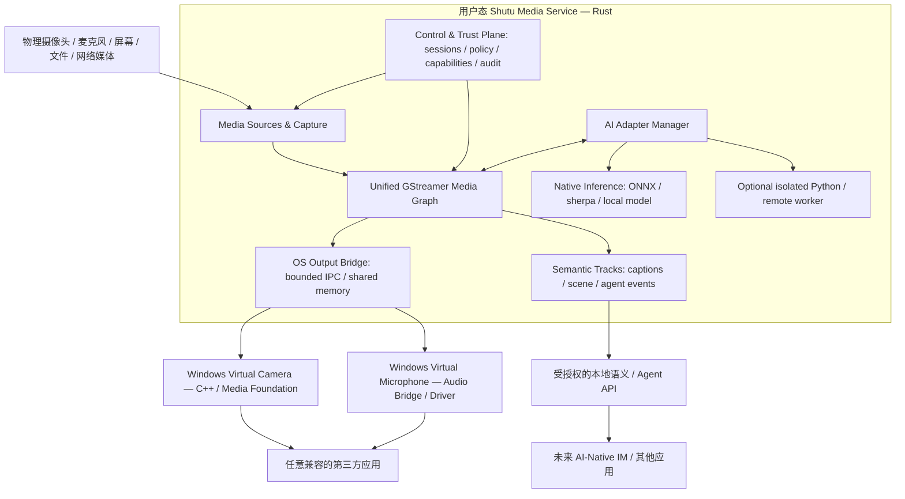

# Shutu AI-Native Media
## 系统级虚拟音视频平台：架构与实施基线（Development Reference）

> **版本**：v1.0（架构基线，待实现验证）  
> **研究基准日期**：2026-11-10  
> **适用范围**：Windows 11 首发；Linux / macOS 预留；后续可被 AI-Native IM 和第三方通信应用调用  
> **文档属性**：开发主参照（Source of Truth）。任何代码实现、架构偏离或需求变更都应追溯到本文件的需求编号 / ADR / 里程碑。  
> **证据状态**：本文件已对关键官方 API、参考开源项目和许可证进行了资料研究；**尚未在目标机器上完成代码编译、设备安装、性能及兼容性实测**。技术选型是有依据的方案，不代表产品已验证。  
> **目标受众**：个人开发者、Codex / 编码 Agent、代码评审者、测试者及未来维护人员。

---

## 0. 决策摘要（先读本节）

### 0.1 最终产品是什么

开发一个**操作系统可识别的 AI 虚拟麦克风与 AI 虚拟摄像头**，其后方由统一的跨平台音视频运行时提供实时媒体处理和可替换的 AI 能力。安装后，用户可在支持标准设备选择的应用中选择：

- `Shutu AI Camera`：真实摄像头、虚拟背景、合成视频、数字人或 AI 处理视频的统一输出。
- `Shutu AI Microphone`：真实麦克风、降噪/变声/翻译生成语音、AI 语音的统一输出。
- `Shutu Media Control`：设备授权、媒体路由、场景切换、模型管理、可观测性、隐私开关。

**注意**：传统 OS 虚拟设备本身只暴露标准音视频数据流；结构化字幕、场景语义、Agent 事件等通过**单独且需授权的控制/语义 API**传递，不能假设普通会议软件会自动理解这些信息。

### 0.2 当前已作出的核心选择

| 决策编号 | 确认方向 | 边界 / 不做什么 |
|---|---|---|
| ADR-001 | Rust 作为用户态 Media Runtime 的主要语言 | 不将 Python、远程 LLM、Go GC 放入硬实时音频回调 |
| ADR-002 | GStreamer 作为首版媒体管线执行底座 | 不重新开发编解码、时钟、格式协商与成熟 Pipeline |
| ADR-003 | Windows 11 优先，Media Foundation 虚拟摄像头 | 不先发明 Windows 虚拟摄像头驱动 |
| ADR-004 | Windows 虚拟麦克风单独立项评估，参考 SysVAD | 不假定可仅用虚拟摄像头 API 创建虚拟麦克风；不在日常工作电脑开启测试签名 |
| ADR-005 | 音频与视频统一 **Track / Session / Clock / Capability / Policy / Event** 契约 | 不强行让所有处理节点使用同一种算法、线程和延迟预算 |
| ADR-006 | OS Adapter 与 AI / Media Runtime **进程隔离**，优先本地 IPC | 不让媒体源 COM 组件直接加载大模型或控制 GUI |
| ADR-007 | AI Provider 可替换；原生推理优先，Python 仅可选外部 Worker | 不固定 ASR → LLM → TTS 为唯一模式 |
| ADR-008 | LiveKit / Pion 作为未来 IM 传输层或实验消费者 | 不作为虚拟设备基础运行的前置依赖 |
| ADR-009 | 首个里程碑必须验证“OS 能识别并消费设备” | 不先开发完整 IM、数字人产品或通用 Agent 编排平台 |
| ADR-010 | 安全、许可、可卸载与证据化验收是上线门禁 | 不通过关闭操作系统安全机制实现常规安装 |

### 0.3 三条路线不能混淆

1. **主线（必须交付）**：Windows 虚拟摄像头 → Rust/GStreamer 单一媒体运行时 → 可用的虚拟麦克风 → 稳定的音视频输出。
2. **能力线（可渐进）**：本地降噪、实时转写、字幕合成、AI 视频处理、音视频联合模型、Agent 事件。
3. **扩展线（不能阻塞主线）**：Linux/macOS、WebRTC/LiveKit、未来 AI-Native IM、真正的 Windows 虚拟音频驱动分发与签名。

**第一版成功标准**不是“拥有最强 AI”，而是“在常见应用中稳定出现并使用两个 OS 级设备；AI 可关闭、可替换，视频与音频可同步、安全地运行”。

---

## 1. 背景、定位和边界

### 1.1 长期愿景

> 模型能力越强，媒体平台能够执行的任务越复杂；同时不应重写 OS Device Adapter、基本媒体传输、同步、隔离、安全与授权机制。

最终形成“OS 虚拟设备 + 多模态媒体运行时 + Agent-ready 语义接口”的通用基础设施，可用于会议软件、即时通信、直播、桌面辅助交互和后续智能硬件。

### 1.2 V1 目标（P0）

- **FR-001**：在 Windows 11 支持的构建版本上注册、枚举、启停 `Shutu AI Camera`。
- **FR-002**：在受控 Windows 测试环境中验证虚拟麦克风可被普通录音应用枚举和读取；生产级自研驱动上线另设门禁。
- **FR-003**：两个设备从一个媒体会话读取统一 Runtime 输出，可独立启停。
- **FR-004**：支持“原始媒体旁路”“无 AI 处理”“单个 AI 节点处理”和“多个 AI 节点处理”模式。
- **FR-005**：支持本地静态/测试帧、真实摄像头、真实麦克风；通过设备授权控制采集。
- **FR-006**：视频/音频均具备格式协商、时间戳、缓冲边界、故障降级与观测指标。
- **FR-007**：模型超时/崩溃不得拖垮 OS 虚拟设备或已建立的非 AI 通路。
- **FR-008**：安装、更新、卸载能可靠清理注册项、设备实体和残留进程（音频驱动须单独验证）。
- **FR-009**：所有设备采集、上传、生成与 AI 参与均可被用户看见、批准和撤销。

### 1.3 V1 暂不包含（Non-goals）

- 自研完整即时通信客户端、联系人/群组/消息数据库。
- 自己实现 WebRTC SFU、编码器、虚拟音频内核框架或深度学习训练框架。
- 承诺支持**所有**第三方会议应用、所有 Windows 构建、所有硬件和所有 GPU。
- 未经通知的后台监听、静默采集、自动上传私人媒体。
- 全实时生成式视频、自动数字人和复杂 Agent 自主操作。它们属于后续能力验证，不构成 V1 阻塞。
- 以绕过系统隐私、安全、驱动签名的方式完成产品化。

### 1.4 合理的首次演示

Windows 11 上安装组件后，打开 Windows Camera / 浏览器 / 视频采集软件，选择 `Shutu AI Camera`；画面从静态测试卡切到真实摄像头，再切换到 AI 背景效果，软件无需重启且不被 AI 模型异常拖垮。另在录音应用选择 `Shutu AI Microphone`，能够输出经过统一媒体服务处理的语音，关闭 AI 后恢复原始/受控备用路径。此演示可在不运行 LiveKit 或任何 IM 服务器的情况下完成。

---

## 2. 可行性事实、主要风险和优先次序

### 2.1 Windows 摄像头：用户态途径已经存在

Microsoft `MFCreateVirtualCamera` 可注册系统虚拟摄像头，最低支持 Windows Build 22000；支持会话或系统生命周期，当前用户 / 所有用户范围有不同授权要求。官方 [Windows-Camera VirtualCamera Sample] 展示 C++ Custom Media Source、注册安装、合成视频和现有摄像头包装等模式 [S1][S2]。

**工程含义**：首版以官方 Sample 的 **Synthetic source → Runtime 共享内存帧** 为最小修改路径；禁止直接在 Sample 内部加入 AI 图引擎。

**必须核对**：Frame Server 中 Custom Media Source 的服务账户、Session 0、进程位数、权限、COM 激活、生命周期、卸载与高频帧获取。Sample README 显示媒体源会在 FrameServer 中运行，因此 IPC 的安全和跨会话行为不能留到产品化阶段才解决 [S2][S3]。

### 2.2 Windows 麦克风：是更大的工程风险

Windows 系统音频输入设备涉及音频端点与驱动栈；微软 `SysVAD` 示例可创建虚拟音频设备，但示例并不等于可直接发布的通用虚拟麦克风。官方文档明确列出 WDK、单独测试目标环境、测试签名/证书以及生产签名相关要求，并指出示例混音/loopback 存在模拟局限 [S4][S5]。

**因此采用双轨制**：

- **Track A（MVP）**：在测试机上使用合法可用、用户主动安装的虚拟音频路由软件/现有端点进行桥接，先验证 `Shutu Media Engine → 录音应用` 的音频内容、时钟、稳定性和 UI。此类第三方组件需独立查许可证和分发条件，不默认随产品捆绑。
- **Track B（产品化研究）**：隔离开发环境中从 SysVAD 出发实现自己的音频捕获端点、环形缓冲传输、驱动安装卸载与签名计划。未通过真实目标机器、驱动签名、HLK/认证和安全评审前，不承诺可分发生产版虚拟麦克风。

**硬性限制**：不得在主力办公机、企业受控机上为试验驱动禁用安全功能；不建议绕过 Secure Boot/BitLocker；如需测试签名仅在专用、可恢复测试机器按照官方流程操作，随后恢复安全设置。

### 2.3 Rust、GStreamer 的现实边界

Rust 无 GC 停顿，适合用户态实时媒体服务，但 Rust **不自动等于硬实时**。GStreamer 提供 Pipeline、Clock、Buffer 时间戳、Segment、格式协商、Appsink/Appsrc 等机制；队列须有上限，避免 AI Worker 停顿时内存无限增长 [S6][S7][S8]。

**首版不再做一套可替代 GStreamer 的图执行内核**。自主核心是能力契约、会话、安全策略、动态 AI 节点适配和 OS Device Bridge；底层实际媒体执行基于 GStreamer。

---

## 3. 目标架构（单核心、三平面）



### 3.1 Media Data Plane

运行真实采集、音视频混合/变换、格式转换、时钟同步和虚拟设备输出。必须具备没有 AI 时的可靠通路。高优先级线程不得依赖云端 API。

### 3.2 AI Intelligence Plane

以可替换的 `AIProvider` 节点完成：降噪、VAD、转写、翻译、TTS、视频抠像、画面理解、音视频联合理解、生成视频等。允许多节点路径，也允许单一端到端模型路径。AI 输出可映射到音频/视频 Track 或语义 Sidecar Event。

### 3.3 Control & Trust Plane

管理用户授权、设备生命周期、图版本、会话状态、模型能力、设备选择、录音/上传同意、审计、日志与故障恢复。任何 AI Provider 都不能绕开该平面直接接管虚拟设备驱动。

### 3.4 进程边界（MUST）

| 进程/模块 | 语言 | 责任 | 不得执行 |
|---|---|---|---|
| `shutu-media-service` | Rust | 媒体处理、管线、调度、AI Provider 管理、IPC | 注册 Windows 内核驱动；进行未经许可的系统级操作 |
| `shutu-virtual-camera` | C++ COM/MF | 从共享缓冲获取已准备帧，提供虚拟摄像头 MediaSource | 阻塞等待模型 / 网络；内嵌复杂 AI Runtime |
| `shutu-virtual-mic` / `audio-bridge` | Windows 驱动 / 原生桥接 | 将已准备的 PCM 按设备要求提供给音频栈 | 调用 LLM、执行非确定性重操作 |
| `shutu-control` | Rust + 可选 Web UI | 显式设备/模型权限、配置、预览、状态 | 绕过 OS 隐私对话框 |
| `ai-worker-*` | C++/Rust 或可选 Python | 受限媒体副本/片段处理、推理结果回传 | 直接持有系统虚拟设备注册控制权 |

> **Windows 特别事项**：Frame Server 以低权限服务账户、Session 0 运行的 Custom Media Source 有特殊文件和桌面访问限制 [S3]。虚拟摄像头进程如何连接用户会话媒体服务必须在 M0 用真实工具验证（账户、ACL、共享内存访问、服务重启和多用户）；不能仅在同一交互式进程中模拟成功。

---

## 4. 统一 Media 契约：为将来 AI-Native Video 预留

### 4.1 “统一”指什么，不指什么

**统一**：一个 Session 模型、一套时间戳语义、一套节点能力发现、一个控制/授权体系、一套拓扑变更与降级机制、一套可追踪事件。  
**不统一**：音频/视频编码数据的具体格式、缓冲深度、采样率、线程优先级、模型处理时间及视觉/听觉算法本身。

### 4.2 建议核心数据结构（逻辑契约，非已实现代码）

```rust
// 概念性伪接口；首版在 contracts/ 内定义并冻结 v0.1 格式。
enum TrackKind { Audio, Video, Subtitle, SemanticEvent }

enum OriginKind { PhysicalDevice, File, Network, GeneratedAI, SyntheticTest }

struct MediaTimestamp {
    clock_domain_id: u64,
    monotonic_capture_ns: u64,     // 可用时；与设备时钟映射
    presentation_ns: u64,          // 同会话基准下的 PTS
    duration_ns: u64,
}

struct MediaFrameEnvelope {
    session_id: String,
    track_id: String,
    seq: u64,
    origin: OriginKind,
    ts: MediaTimestamp,
    format_id: String,             // 由 Track caps 定义 PCM/NV12/BGRA 等
    payload_ref: u64,              // 本地 IPC handle / slot；不是跨机器指针
    graph_version: u64,
    trace_id: String,
}

struct MediaCapability {
    capability_id: String,         // 例：audio.asr.streaming / video.background.remove
    input_kinds: Vec<TrackKind>,
    output_kinds: Vec<TrackKind>,
    supports_streaming: bool,
    supported_formats: Vec<String>,
    max_expected_latency_ms: u32, // provider 声明；运行时实测覆盖
    privacy_scope: String,        // local-only / explicit-cloud-consent
    cancellation_supported: bool,
}
```

上述结构是**跨模块逻辑模型**。实时热路径建议采用稳定的二进制布局或共享内存缓冲描述符，避免每帧动态字符串、序列化和内存分配；字符串/丰富元数据放在控制平面。跨版本协议必须明确头部魔数、版本、长度、对齐方式、端序、句柄生命周期。

### 4.3 会话与轨道生命周期

- `Session`: `CREATED → AUTHORIZED → READY → RUNNING → STOPPING → STOPPED / FAILED`。
- `Track`: `CREATED → NEGOTIATED → ACTIVE → MUTED / PAUSED → CLOSED`。
- `Graph`: `PROPOSED → VALIDATED → PREPARED → ACTIVE → DRAINED`，配置热切换需版本标识。
- `AIJob`: `REQUESTED → APPROVED → RUNNING → COMPLETED / CANCELLED / TIMED_OUT / FAILED`。
- 关闭录音权限必须立即阻止新的音频数据进入 AI 支路；缓冲中未授权保留的媒体应按策略清空。
- OS 虚拟设备可独立于 AI Job 存活；设备输出可在 `READY` 状态输出可辨认的测试卡/安全静音。

### 4.4 时间模型与同步契约

- 系统内唯一的**会话运行时间轴**；采集源可有独立设备时钟域，必须记录映射与漂移调整。
- 基于 GStreamer Clock、PTS、Segment 和 Pipeline Latency 实现同步；不自行设计另一套互相竞争的播放时钟 [S6]。
- AI 生成音视频需要携带同一时间域中的内容时间戳；若模型只给出分块音频或未对齐帧，则由 Provider 明确声明时间精度，并由同步节点估算/重采样。
- 语义事件（字幕、对象检测、Agent 推理结果）携带对应媒体时间区间，不得与原始采集时间混为一谈。
- **推理结果延迟到达**：若已错过呈现窗口，应丢弃、转为非实时事件或按策略更新下一帧，不能无限延迟实时音视频。

### 4.5 Capability Graph / Provider 契约

系统定义 `MediaSource → MediaProcessor → MediaSink`，包含可旁路节点、AI Provider、转换节点、语义 Sidecar。每个 Provider 宣告输入/输出类型、支持格式、延迟、是否联网、权限和健康状态。编排时遵循：

1. 先确认用户目标与数据授权（如降噪、双语字幕、背景移除）。
2. 从已获许可、已可用的 Provider 中选择可满足能力需求的实现。
3. 检查 Track/Caps、时延预算、同步、模型依赖、算力与内存资源。
4. 构建或更新 GStreamer Pipeline / AI 桥接节点，提交版本化配置。
5. 运行时根据延迟、故障与权限变化采取旁路、退化或停止输出。

**避免过度设计**：M0–M2 只实现配置驱动的少数固定合法 Pipeline 和受限切换；在证明多个真实应用场景存在后，再建设通用能力图规划器。

### 4.6 将来 AI-Native Video 的五种形态都要能表达

| 场景 | 输入 | 统一输出 | 关键约束 |
|---|---|---|---|
| 背景模糊/抠像 | 原始 Video | Video Track | 帧时延、GPU 资源 |
| 实时画面理解 | 稀疏 Video / 屏幕 | SemanticEvent | 隐私授权、采样率、延迟容忍 |
| 语音驱动虚拟人物 | Audio / 文本 | Audio + Video | 口型对齐、共同时钟 |
| 生成式实时视频 | 语义 / 语音 / 图像 | Generated Video Track | 生成超时、帧率波动、备用画面 |
| 多模态 Agent 协作 | Audio + Video + 语义 | 语义/生成媒体 | 谁能看/听、说话权、参与者可见性 |

系统虚拟摄像头只负责发布最终的视频 Track；不必知道图像由真实摄像头还是 AI 模型生成。这正是“更强模型无需重写 OS 设备”的关键。

---

## 5. OS 设备实现方案

### 5.1 Windows 虚拟摄像头（首个技术穿透点）

**采用**：`MFCreateVirtualCamera` + COM `IMFMediaSource`，从官方 `Windows-Camera/Samples/VirtualCamera` 起步 [S1][S2]。

**最小路径**：

1. 在独立 Windows 11 测试环境构建官方 Sample，不修改 SDK 安全设置。
2. 使用 Sample 生成纯色/测试卡，注册、枚举、Start/Stop/Remove。
3. 在 Windows Camera（以及第二种独立应用）中选择并读取。
4. 新增 IPC Input：先走**共享内存 CPU 帧**（如 BGRA / NV12；具体由协商与性能测试确定）；不要在起步阶段做跨进程 GPU 纹理共享。
5. `shutu-media-service` 按 Track/Caps/PTS 向 IPC ring 写帧；MF Source 从 ring 读帧，输出已准备好的 Video Sample。
6. 服务断开时，虚拟摄像头输出稳定占位帧并报告设备健康；重连后恢复，日志有清晰事件。
7. 验证重复安装、卸载、用户切换、长时运行、多消费者场景，形成兼容性矩阵。

**禁用模式**：不在 Frame Server 的 COM 回调中调用网络 API、AI 推理或等待超过明确预算的 IPC；严禁未验证的无限等待。

### 5.2 Windows 虚拟麦克风（风险最高）

**产品路线**：SysVAD 音频驱动 + 用户态共享缓冲生产 PCM；具体结构必须通过 WDK PoC 验证后冻结 [S4][S5]。

**Track A：先验证音频流与已有合法虚拟端点的互通**

- 初期通过用户自行安装、许可明确的虚拟音频路由工具作测试桥接，或使用测试专用已有端点。
- Runtime 输出 `48 kHz / 16-bit / mono` 为 V1 默认参考格式（也允许 OS 端协商其他格式），从外部播放或循环声音检查录音一致性。
- 该 Track 的成功 **不能**被描述为“自研虚拟麦克风驱动完成”。

**Track B：SysVAD 研发**

- 首先在专用驱动测试机构建、运行官方 Sample，严格按当前 WDK / Windows Hardware 文档配置。
- 明确 capture endpoint、render path、DMA/WaveRT、音频格式、时钟、PCM 输送、underflow/overrun、断线备用行为。
- 只将经授权、已准备的 PCM 送入驱动可读的缓冲区；内核或高优先级音频回调不得参与 AI 推理。
- 驱动安装、签名、升级、卸载、系统重启、异常恢复、HLK 与终端安全兼容性另设交付门禁。
- 如果签名/认证成本和风险不可接受，发布阶段可维持“虚拟摄像头 + 外部音频桥接”的受限产品，而不虚假宣传为完整双虚拟设备。

### 5.3 IPC & Buffer 边界

| 流量 | V1 机制 | 重要限制 |
|---|---|---|
| 控制与状态 | Windows Named Pipe / 本地受限 IPC | 校验调用者身份和 ACL，消息版本化、限速与超时 |
| 视频数据 | 预分配共享内存 Ring Buffer + 帧描述符 | 先 CPU 内存；用代际序号防止旧帧/句柄重用 |
| 音频数据 | 固定尺寸 PCM Ring Buffer | 音频设备节奏优先，超时使用静音或安全旁路 |
| 语义/字幕 | 独立事件通道 | 不阻塞实时媒体帧；必须有时间戳与授权范围 |
| AI Provider | 进程内原生库或独立受限 Worker | 有界输入队列、取消、超时和健康监测 |

**GPU 优化时机**：仅当 CPU 路径达到明确性能瓶颈时，评估 D3D11 共享纹理、同步原语与跨进程 GPU 资源；不要为“未来可能”提前引入多种零拷贝方案。

### 5.4 Linux / macOS 后续适配

- **Linux**：评估 PipeWire 虚拟音频源（Loopback/Combine Stream）以及 PipeWire/V4L2 生态下的摄像头输出；需按目标发行版、会话管理器和目标应用验证 [S10]。
- **macOS 摄像头**：CoreMediaIO Camera Extension 可发布系统可选摄像头（macOS 12.3+），需要遵循扩展、Entitlement 和部署机制 [S11]。
- **macOS 音频**：Core Audio Audio Server Plug-in / Driver Extension 参考 Apple 官方范例，并单独验证系统权限与签名 [S12]。
- 不承诺 M0–M4 实现跨平台；只承诺跨平台 Contract 不暴露 Windows 私有 handle 作为公共 API。

---

## 6. 模型集成：AI 能力增强但不绑死模型

### 6.1 首批模型能力

- P0：AI 关闭/旁路；本地基础降噪或轻量视频滤镜作为可测可切换节点。
- P1：本地 VAD、流式 ASR、字幕事件；音频旁路必须正常。
- P2：翻译、TTS；支持经授权的 AI 音频替换或混合，控制回声与重复讲话。
- P3：视频背景/人物分割、抽帧视觉理解、数字人/生成视频、联合实时音视频模型。

### 6.2 Provider 双路径

1. **Native in-process / native isolated**：Rust/C++ 绑定 ONNX Runtime、sherpa-onnx、经过审核的 GStreamer 插件，优先本地执行；部署时检查模型权重、许可证和硬件需求。ONNX Runtime 提供多类 CPU/GPU Execution Provider，但具体硬件兼容性需要逐机实测 [S13][S14]。
2. **Remote / Python Worker**：只有在明确允许并授权时使用；Python 独立进程，输入由 Frame Sampler 或音频片段供给；不得控制音频设备时钟和阻塞 OS 虚拟设备输出。

### 6.3 统一 Provider 描述

```yaml
# 示例，不是已上线的配置规范
id: local-asr-zh-en
api_version: media.capability/v1
kind: audio.asr.streaming
input: [audio/pcm_s16le]
output: [event/transcript.partial, event/transcript.final]
execution: native-isolated
privacy: local-only
supports_cancel: true
latency_budget_ms: 500   # 研发初始预算，非性能保证
fallback: bypass
```

### 6.4 不可省略的降级策略

- **普通视频处理失败**：优先恢复原始画面；禁止无声地继续上传到替代云模型。
- **生成视频失败**：改为占位帧/用户已选择的静态画面；不能泄露最后一次未经授权保留的历史视频帧。
- **音频推理超时**：根据模式恢复原始音频或静音；不可重放过期的语音片段。
- **音视频联合模型落后**：允许在明确质量策略下丢弃过期生成帧，严禁无限堆积。
- **授权撤销**：AI 分支必须停止并清空相关有界缓存；OS 设备是否继续提供空白/静音由用户设置决定。

---

## 7. 核心性能指标及测量方法

> **说明**：以下数值是**首版工程验收目标**，不是未经测试的实现承诺。正式冻结 SLO 前，必须记录 Windows Build、CPU/GPU、摄像头、驱动、GStreamer 版本、场景、采样窗口与测量方法。

| ID | 初始测试条件 | 指标 / 门槛 | 如何测量 |
|---|---|---|---|
| NFR-01 | 720p、30 fps、无 AI，本地虚拟摄像头 | 目标稳定 30fps；连续 30min 无死锁/崩溃 | 统计收到帧、输出帧与时间戳；保存日志 |
| NFR-02 | 无 AI，48kHz、单声道、10ms 音频块 | 连续 30min 无持续音频断流；underrun 事件完整统计 | 生成固定测试音，录音比对与缓冲事件统计 |
| NFR-03 | 本地同机通路、无 AI | Camera 输出新增时延 p95 目标 ≤ 150ms | 通过同步闪光测试卡或时间戳摄影法测量输入到可消费帧 |
| NFR-04 | 本地同机通路、无 AI | Microphone 输出新增时延 p95 目标 ≤ 100ms | 电信号/声学 loopback + 波形对齐；注明路径 |
| NFR-05 | 基础无 AI 媒体流水线 | A/V 相对时间偏差目标 ≤ 80ms | 同步拍手/闪光媒体和关联 PTS/回放验证 |
| NFR-06 | AI Worker 强制停止 | OS 设备不中断注册；在 2s 内进入已定义备用模式 | Kill Worker、观察应用和 Health Event |
| NFR-07 | 队列压力测试 | 内存/队列保持有界，无持续线性增长 | 关闭消费端、减速处理端、持续 30min 采样 |
| NFR-08 | 权限撤销 | 禁止新增未授权媒体输出/上传，相关任务取消并清理队列 | 权限事件 + 本地网络/文件追踪 |
| NFR-09 | 开始/停止、重启、重装 | 没有孤儿进程、遗留设备或可利用 ACL | 自动化安装/卸载清单与手工复核 |
| NFR-10 | 模型 A/B 对比 | 同一任务基准集上完成率/质量、成本、CPU/GPU 与时延可比较 | 固定素材与指标脚本，保存对照证据 |

**解释**：把“新增时延”与“音频/视频端到端 AI 响应时间”分开；实时翻译/数字人可以有自己的较高时延预算，不得借助队列积压拖慢普通通话。

---

## 8. 开源参考与选型矩阵

| 项目 | 推荐角色 | 引入策略 | 许可证/注意事项 |
|---|---|---|---|
| [Microsoft Windows-Camera VirtualCamera](https://github.com/microsoft/Windows-Camera/tree/master/Samples/VirtualCamera) | Windows 摄像头实现基准 | 必须研究/复现实例；少量可控复用 | 示例集成时检查仓库及子文件许可证、安装依赖 |
| [Microsoft SysVAD](https://github.com/microsoft/Windows-driver-samples/tree/main/audio/sysvad) | Windows 音频驱动基准 | 独立 PoC / 研发支线 | WDK、签名、安装、HLK、受控机器风险 |
| [GStreamer](https://gitlab.freedesktop.org/gstreamer/gstreamer) | 音视频处理、时钟与媒体同步 | 核心依赖 | GStreamer 核心 LGPL-2.1-or-later；具体插件可能有不同许可/专利 |
| [gst-plugins-rs](https://github.com/GStreamer/gst-plugins-rs) | Rust 媒体插件参考 | 按需导入 | 仓库包可能 MIT/Apache-2.0/MPL-2.0，逐包检查 [S9] |
| [ONNX Runtime](https://github.com/microsoft/onnxruntime) | 原生模型推理 | 模型支持层，可选运行时 | 执行 Provider、GPU 分发及模型许可独立审核 |
| [sherpa-onnx](https://github.com/k2-fsa/sherpa-onnx) | 本地 ASR/TTS/VAD | 优先参考，后续接入 | Apache-2.0 项目；模型权重分别审核 [S14] |
| [Pipecat](https://github.com/pipecat-ai/pipecat) | 流式语音 Agent 交互参考 | **参考，不设为核心依赖** | Python 及原有管线模式不适合 OS 实时媒体核心 |
| [TEN Framework](https://github.com/TEN-framework/ten-framework) | 实时 Agent 插件架构参考 | 仅研究 | 部分目录 Apache-2.0 含附加限制，需法务审查 [S15] |
| [LiveKit](https://github.com/livekit/livekit) | 未来 IM 通话传输 / 测试消费者 | 后续扩展 | Server Apache-2.0；不阻塞虚拟设备 [S16] |
| [Pion WebRTC](https://github.com/pion/webrtc) | Go WebRTC 协议研究 | 不进入 V1 核心 | 未来需要 Go 通信服务时评估 |
| [PipeWire](https://pipewire.pages.freedesktop.org/pipewire/) | Linux OS Media Adapter | 第二平台阶段 | 结合 Linux 会话管理器验证 |
| [Apple CoreMediaIO / Core Audio](https://developer.apple.com/documentation/coremediaio/) | macOS OS Media Adapter | 第三平台阶段 | Entitlement、签名、部署机制优先 |

**依赖规则**：每次引入第三方仓库、模型权重、音视频 Codec、GPU 推理包或驱动二进制，必须写入 SBOM：版本、commit/tag、来源 URL、许可证、分发条款、是否动态/静态链接、是否有安全更新通道。不要根据“项目根仓库开源”推断全部权重、插件、模型服务均可免费商用。

---

## 9. 开发里程碑与阶段门禁

> 建议采用**单人可持续迭代**的方式。表中估算仅用于容量规划，依赖平台和硬件环境，不能当作交付承诺。任何阶段未通过 Gate，不继续叠加下一阶段的复杂功能。

### M0：环境与可行性验证（建议 1–2 周）

**目标**：先消除最可能造成整条路线失败的 OS 技术风险。

任务：

1. 记录 Windows 版本、SDK、Visual Studio、C++ 工具链、WDK（如有）和 Rust/GStreamer 环境。
2. 从官方 VirtualCamera 示例编译安装合成帧虚拟摄像头。
3. 验证至少两个独立应用能枚举、打开、关闭虚拟摄像头。
4. 验证服务身份、Frame Server 加载与可观察的日志；设计 IPC 身份认证 PoC。
5. 单独研究 SysVAD 构建条件和驱动安全、签名成本，输出风险结论（本阶段不要求自研音频驱动完成）。
6. 创建最小 `contracts/` 和自动化证据格式。

**Gate G0**：camera synthetic works；实际测试程序、Windows Build、安装和卸载步骤可重复；SysVAD 风险已形成书面判断。**若摄像头样例均失败，STOP，先排除工具链/环境再写引擎**。

### M1：Rust/GStreamer Media Foundation（建议 2–4 周）

任务：

1. Rust Service 构建 `testsrc → processing → appsink` 基础视频图。
2. 建立跨进程共享内存视频 Ring + Named Pipe 控制；实现 ACL、序号、时钟与故障状态。
3. 将摄像头 MediaSource 的帧来源改为 Runtime 的已准备帧。
4. 实现 safe fallback、重连、受控 720p 30fps、格式协商和状态指标。
5. 加入物理摄像头输入（需权限），避免多个进程争抢设备。

**Gate G1**：Windows Camera 与第二款应用持续使用 30 分钟；AI 为 0 依赖；Runtime 杀进程后设备不崩溃并进入安全备用画面；队列有界。

### M2：统一音视频会话与音频验证（建议 3–5 周）

任务：

1. 统一 Session/Track/Clock/Event/Policy 合同 v0.1。
2. 实现本地物理麦克风捕获、PCM 处理、同步测试卡 + 音频脉冲。
3. 在测试专用可用虚拟音频端点建立音频桥接；确认第三方应用能读取。
4. 测试单独启停、采样率转换、设备热插拔、休眠/唤醒和麦克风权限撤销。
5. SysVAD Track B 开始独立小型研发 PoC，必须与主线解耦。

**Gate G2**：音频及视频在同一 Session 可运作；音频桥接清楚标识非自研驱动；同步与恢复指标有证据；SysVAD PoC 给出 GO / HOLD / STOP 结论。

### M3：AI 能力扩展（建议 3–5 周）

任务：

1. 先加一个本地视频效果节点和一个本地音频效果节点。
2. 定义 Provider Manifest、授权属性、取消、timeout、健康状态和统一降级。
3. 加入本地 VAD/ASR 生成字幕事件；媒体流不依赖 ASR 成功。
4. 设计 AI 音频生成/替换 Output Track（可使用测试合成音作为第一替身）。
5. 用固定测试片段做两个模型 Provider 的替换对比；不改核心 Device Bridge。

**Gate G3**：AI on/off 以及 Provider A/B 切换后 OS 设备正常；Kill AI Worker 后 Gate G1/G2 的非 AI 基线仍通过。

### M4：AI-Native Video 统一能力（建议 3–5 周）

任务：

1. Video background/filter 与 audio ASR 使用相同的 Capability / Policy / Event 协议。
2. 增加异步视频稀疏采样及语义事件；不可默认逐帧上传。
3. 实现 Generated Video Track 的测试提供者（可先用预录/合成帧模拟）。
4. 增加 Audio+Video 关联输出、时间轴和画面异常降级。
5. 编写“一个模型替代多个 AI 节点”的集成测试（可用 mock Provider，不依赖具体商业模型）。

**Gate G4**：模型路径从模块组合切换到端到端模型模拟，**虚拟摄像头/麦克风接口和既有应用无需改动**；A/V 相关事件时间戳可追踪。

### M5：Windows 产品化 Beta（建议 4–8 周，驱动签名另算）

任务：

1. GUI：设备状态、权限开关、AI 开关、模型选择、诊断导出。
2. 安装/升级/卸载，设备冲突检查，支持回滚。
3. 固化版本、发布工件校验（SHA-256）、依赖清单及签名计划。
4. Windows Camera、浏览器、OBS / 录音应用兼容性矩阵；会议应用按实际测试添加。
5. 测试硬件、压力、重启、睡眠唤醒、权限撤销、异常恢复，完成 Release Evidence。
6. 根据音频驱动 Track B 状态决定：**双设备完整 Beta** 或 **摄像头正式 Beta + 音频独立实验版**。

**Gate G5**：没有 P0 缺陷；无未授权媒体上传；可干净卸载；技术债、签名状态和支持应用清单清晰。若虚拟麦克风的签名与兼容性未达标，禁止声称完整交付。

### M6（后续）：Linux/macOS + IM 消费者

以 OS Adapter 契约为前提添加平台；再以 LiveKit/WebRTC 发布媒体 Track 给 AI-Native IM。**不反向依赖 IM 才能运行设备**。

---

## 10. 核心测试计划与证据

### 10.1 测试类型

| 类型 | 必做示例 | 证据 |
|---|---|---|
| 单元测试 | Session 状态机、能力匹配、格式检查、取消、超时 | 测试报告 |
| Contract 测试 | C++/Rust IPC 版本不一致、坏长度、坏句柄、重放 seq | 协议测试日志 |
| 媒体处理测试 | NV12/BGRA/PCM，时间戳单调、队列上限、帧丢弃 | 固定测试素材 + 脚本 |
| 系统集成 | Windows Camera/浏览器/录音应用是否识别设备 | 应用版本、截图、枚举日志 |
| 故障注入 | Runtime/Worker kill、设备热拔、CPU 降速、权限撤销 | 恢复时序与崩溃日志 |
| 安全测试 | 未授权媒体源请求、Named Pipe ACL、路径操纵、日志泄漏 | 检查单 / 可复现 PoC |
| 性能测试 | 延迟 p50/p95/p99、掉帧、CPU/GPU、内存、音视频偏差 | 原始数据、采样时间、硬件信息 |
| 安装测试 | 全新安装、覆盖升级、重启、卸载、恢复 | 安装卸载清单 |
| 许可证测试 | SBOM、模型权重、Codec、第三方桥接工具 | 许可清单与审查结论 |

### 10.2 兼容性矩阵：最低组合

- Windows 11 一台**可控制权限的测试机**（记录精确 Build，x64 优先），加一台隔离的驱动测试目标环境（需要时）。
- 虚拟摄像头：Windows Camera、Chromium 浏览器 `getUserMedia` 页面、OBS 或同类采集工具；后续可增加主流会议软件但**不能事先承诺全部可用**。
- 虚拟麦克风：录音/波形工具、浏览器音频采集页、需要时主流会议软件。
- 测试输入：无设备 synthetic、720p 30fps 摄像头、48kHz PCM 测试音、设备断连、权限撤销、不同麦克风采样率。

### 10.3 每个 Gate 都输出固定 Evidence

```text
artifacts/<gate>/<run-id>/
  environment.json        # Windows Build、SDK、CPU/GPU、依赖版本
  build.log                # 可重现的构建结果
  test-results.json        # 用例、通过率、失败原因
  perf.json                # 定义指标及采样
  device-enumeration.txt   # OS 设备枚举与句柄信息
  screenshots/             # 真实运行证据，脱敏处理
  security-checklist.md
  licensing-sbom.json
  decision.md              # GO / HOLD / STOP, 未解决问题
```

**绝不将“代码通过 CI”误报为“Windows 虚拟设备已在真实应用验证”。**

---

## 11. 安全、隐私与合规（不能后补）

1. **默认本地**：默认模型不上传媒体；远程 Provider 在每次作用域变更时要求明确授权。音频/视频是否允许发送到外部 API 必须独立配置。
2. **显式媒体状态**：控制面板和系统设备状态清楚显示正在采集/处理/发送哪些 Track；AI 参与和生成内容必须可识别。
3. **最小权限**：Frame Server 组件、Windows Service、用户会话、AI Worker、控制 UI 的权限分别审查；命名管道及共享内存通过严格 ACL 和连接身份绑定。
4. **失败时收敛**：系统组件出错不能绕开授权自动回到真实摄像头/麦克风；是否旁路须先满足用户策略和权限状态。
5. **默认不保存内容**：日志只包含时序、设备、异常和性能元数据；原始媒体样本需要专门调试开关、明确同意、短期限时保存。
6. **抵御提示注入**：来自语音/视频识别的文本是**不可信输入**，不能未经授权触发系统命令、打开文件、泄露会话或更改设备策略。
7. **生成媒体透明性**：当视频或音频由 AI 合成，可通过 Control API 提供明确来源元数据；必要时使用 UI 标识。普通虚拟设备通道不保证第三方应用显示这些标识。
8. **录音与会议同意**：不同国家/业务场景要求不同；实现可见授权与可撤销机制，正式发布前按发行地/目标用户群评估适用法规。
9. **驱动与更新**：签名/安装失败时安全回滚；禁止为常规用户关闭 Secure Boot、设备防护或系统隐私控制。

---

## 12. 风险登记册与技术决策门

| 风险 ID | 风险 | 影响 | 缓解与决策门 |
|---|---|---|---|
| R-01 | Windows 虚拟麦克风驱动开发/签名成本高 | 高 | Track A/B 并行；G2 决定是否产品化；不得与 Camera 完成度混为一谈 |
| R-02 | Frame Server 中源组件无法访问用户进程 IPC | 高 | M0 先测 Local Service / Session 0 / ACL；准备可信本地代理或共享内存服务方案 |
| R-03 | 用户摄像头被独占、多应用冲突 | 中高 | 统一采集服务；依托 OS 摄像头共享能力，禁止盲目二次独占打开 |
| R-04 | GStreamer 动态图和格式协商复杂 | 中高 | 固定可行 pipeline 起步；每个 caps 变更测试；延后通用调度器 |
| R-05 | AI 推理导致背压、音画延迟 | 高 | 分离热路径、有界队列、任务超时和旁路，明确 frame-drop 策略 |
| R-06 | 模型/Codec/插件许可证不兼容商用 | 高 | 每个包与权重独立 SBOM；静态链接、专利另审 |
| R-07 | OS / GPU / 编解码环境差异导致兼容问题 | 中高 | CPU 基线路径先通过，再开启 GPU，分环境矩阵 |
| R-08 | 虚拟设备隐私与被动监听担忧 | 高 | 可撤销权限、显式状态、本地优先、默认不存媒体 |
| R-09 | 提前开发 IM 稀释研发资源 | 中 | LiveKit/IM 作为消费端，不进入主线里程碑 |
| R-10 | 过早设计“万能 AI Graph”变成大工程 | 中高 | 先两条真实音视频 Pipeline，再抽象；禁止无需求的插件层 |
| R-11 | 企业 VPN/安全软件阻止安装驱动或 IPC | 中高 | 在可控测试机与清洁 Windows 镜像验证；不得规避企业策略 |
| R-12 | 预览工具自身独占设备使其他软件无法使用 | 中 | 预览采取共享客户端/受控读取，测试多消费者与显式互斥策略 |

---

## 13. 仓库建议结构

```text
Shutu-AI-Native-Media/
├── README.md
├── docs/
│   ├── ARCHITECTURE_BASELINE.md     # 本文件作为唯一架构主文档
│   ├── adr/                         # ADR-001... 决策变更记录
│   ├── platform-windows.md
│   ├── threat-model.md
│   └── licensing.md
├── contracts/
│   ├── media/                       # Track/Session/Clock/Graph/Event contracts
│   ├── ipc/                         # 版本化二进制协议与安全字段
│   └── capability/                  # Provider Schema
├── runtime/
│   ├── media-core/                  # Rust session / graph / policy / metrics
│   ├── gst-adapter/                 # Rust GStreamer pipeline 封装
│   ├── device-bridge/               # Rust IPC / shared memory ring
│   └── ai-adapter/                  # Provider管理与原生推理桥接
├── platforms/
│   ├── windows/
│   │   ├── virtual-camera/          # C++ Media Foundation source
│   │   ├── audio-bridge/            # 测试阶段的合法音频端点路由
│   │   ├── virtual-mic-driver/      # 独立 WDK SysVAD 衍生研发（隔离）
│   │   └── installer/
│   ├── linux/                       # 后续
│   └── macos/                       # 后续
├── providers/
│   ├── native/                      # ONNX / sherpa 适配
│   ├── remote/                      # 经授权的服务端 AI
│   └── mocks/                       # 模型替换和故障测试
├── apps/
│   └── media-lab/                   # 可视化预览/诊断控制台
├── tests/
│   ├── contract/
│   ├── integration/
│   ├── fault-injection/
│   ├── performance/
│   ├── security/
│   └── fixtures/
├── tools/
│   ├── verify-environment/          # 需实施
│   ├── collect-evidence/            # 需实施
│   └── uninstall-verify/            # 需实施
├── artifacts/                        # 生成结果（应配置 gitignore）
└── third_party/                      # 清单/补丁，不盲目 vendor 完整项目
```

**仓库命名**：推荐 `Shutu-AI-Native-Media`。以上是目标目录，**不表示文件已存在**。

---

## 14. 给 Codex / 开发 Agent 的实施规则

### 14.1 代码执行原则

- 读取本方案，确认当前 `Gate`，只实施该 Gate 的 P0 功能；跨 Gate 改动要说明理由。
- 先证明依赖的官方示例在目标环境上可运行，然后开始自行封装；禁止“先写完整框架再验证 OS 可行性”。
- 新模块必须明确输入/输出格式、线程模型、缓冲上限、超时、权限、日志、关闭释放过程。
- 禁止将低优先级媒体处理、Python Worker、网络/模型调用带入 OS 驱动回调或高优先级音频热路径。
- 任何测试签名、系统驱动安装、安全设置变化都须显式审批；默认仅提供步骤和必要代码，不对个人/企业主机做高风险系统修改。
- 遇到 Windows 平台 API、C++ ABI、GStreamer 插件行为不确定时，提供最小复现和官方依据，不能把推测写成已通过结论。
- 对所有第三方依赖和模型记录版本、来源、许可证；未经许可不自动下载或发送私人音视频。
- 禁止编造 FPS、时延、编译成功、驱动签名、安装和兼容性证明。

### 14.2 完成每个 Gate 必须汇报

```text
GATE=<G0|G1|G2|G3|G4|G5>
STATUS=<GO|HOLD|STOP>
IMPLEMENTED=<已实现模块/commit>
TESTS=<通过数/总数，跳过数>
OS_EVIDENCE=<真实设备枚举及应用验证>
PERFORMANCE=<原始数据路径与测量条件>
SECURITY=<权限/IPC/隐私审查结果>
LICENSING=<SBOM与阻塞问题>
KNOWN_ISSUES=<未解决问题>
NEXT_GATE=<下阶段开始前置条件>
```

`GO` 只表示该 Gate 的明确验收通过，不得推断整个产品完成。机器无法测试 OS 设备时必须给 `HOLD`，不能用 Mock / Linux CI 替代 Windows 设备验证。

### 14.3 变更控制

- 改变三平面边界、`contracts/` 协议、OS Adapter 策略、音频签名策略，必须提交新 ADR。
- 出现与官方文档、当前驱动工具链冲突时，更新“事实依据 + PoC 证据 + 决策”，随后修改基线版本（如 v1.1），禁止静默覆盖。
- 性能数字只有在固定硬件和测试方法下才可调整；原始 benchmark 不得删除。

---

## 15. 发布与验收清单（Definition of Done）

### 15.1 “研发版可运行”最低标准

- [ ] Windows 11 官方 VirtualCamera Sample 构建、注册、运行、卸载证据完整。
- [ ] `Shutu AI Camera` 能被至少两个独立应用识别与消费。
- [ ] Rust/GStreamer 统一 Runtime 通过实际 IPC 提供视频帧（非仅进程内 Mock）。
- [ ] 麦克风被第三方应用识别，且明确说明采用现成音频桥接还是自研驱动。
- [ ] 音视频 Session/Clock/Track 协议实现并通过自动化 Contract 测试。
- [ ] AI 关闭时，虚拟设备继续提供正常媒体。
- [ ] AI Worker 停止/超时后按规则旁路/降级，不导致设备崩溃。
- [ ] 队列/内存上限、时间戳与同步已测量并保留结果。
- [ ] 用户可显式撤销采集和远程 AI 处理权限；日志不含默认媒体内容。
- [ ] 安装/卸载/重启行为可复现；已记录任何驱动签名限制。

### 15.2 “Windows 双设备可分发 Beta”附加门禁

- [ ] 自研音频虚拟设备/其合法分发策略与签名链已明确且达标。
- [ ] 无需让普通用户关闭 OS 安全防护即可安装和卸载。
- [ ] 兼容性矩阵、性能报告、故障注入、威胁模型和 SBOM 通过审查。
- [ ] 应用启动与设备失效行为可预期，可回滚且无持久占用。
- [ ] 用户资料、设备 ID、媒体内容和调试信息遵守最小保留原则。

**若上述任一安全/签名条件不满足：只标注为研发实验版或受限 Beta，不宣称完整商用版。**

---

## 16. 下一步：唯一推荐的启动任务

**先实施 M0，不启动通用 Agent Graph、IM 客户端、复杂 AI 视频生成或自研驱动大工程。**

可直接交给 Codex 的第一条任务目标：

> 在 Windows 11 的受控环境中，基于微软官方 `Windows-Camera/Samples/VirtualCamera` 构建最小虚拟摄像头 PoC。记录 SDK/Build/环境，生成 Synthetic Test Frame，能被 Windows Camera 和一款独立应用打开，验证启停、枚举和卸载；同时确认 Frame Server 的进程/账户约束和后续 Rust IPC 所需权限。完成后输出可复现脚本、测试证据、风险清单和 `G0=GO/HOLD/STOP` 判断。**暂不开发 AI 模型、WebRTC、音频驱动，也不修改系统安全防护。**

此任务验收通过后，再开始 GStreamer / Rust 跨进程帧输送。这样能够将最大的不确定性尽早暴露，避免开发大量无法接入 OS 的 AI 代码。

---

## 17. 参考资料（官方/原仓库优先，查询于 2026-11-10）

- **[S1] Microsoft — MFCreateVirtualCamera API**  
  https://learn.microsoft.com/en-us/windows/win32/api/mfvirtualcamera/nf-mfvirtualcamera-mfcreatevirtualcamera
- **[S2] Microsoft — Windows-Camera VirtualCamera Sample**  
  https://github.com/microsoft/Windows-Camera/blob/master/Samples/VirtualCamera/README.md
- **[S3] Microsoft — Frame Server Custom Media Source security / process constraints**  
  https://learn.microsoft.com/en-us/windows-hardware/drivers/stream/frame-server-custom-media-source
- **[S4] Microsoft — SysVAD Virtual Audio Device Driver Sample**  
  https://learn.microsoft.com/en-us/samples/microsoft/windows-driver-samples/sysvad-virtual-audio-device-driver-sample/
- **[S5] Microsoft — Driver Signing Options / Attestation**  
  https://learn.microsoft.com/en-us/windows-hardware/drivers/dashboard/driver-signing-offerings
- **[S6] GStreamer — Synchronisation (Clock, PTS, Segment)**  
  https://gstreamer.freedesktop.org/documentation/additional/design/synchronisation.html
- **[S7] GStreamer — appsrc**  
  https://gstreamer.freedesktop.org/documentation/app/appsrc.html
- **[S8] GStreamer — appsink**  
  https://gstreamer.freedesktop.org/documentation/app/appsink.html
- **[S9] gst-plugins-rs — Repository and license**  
  https://github.com/GStreamer/gst-plugins-rs
- **[S10] PipeWire — Loopback Module**  
  https://docs.pipewire.org/page_module_loopback.html
- **[S11] Apple — Creating a camera extension with Core Media I/O**  
  https://developer.apple.com/documentation/coremediaio/creating-a-camera-extension-with-core-media-i-o
- **[S12] Apple — Building an Audio Server Plug-in and Driver Extension**  
  https://developer.apple.com/documentation/coreaudio/building-an-audio-server-plug-in-and-driver-extension
- **[S13] ONNX Runtime — Execution Providers**  
  https://onnxruntime.ai/docs/execution-providers/
- **[S14] sherpa-onnx — Project README**  
  https://github.com/k2-fsa/sherpa-onnx
- **[S15] TEN Framework — Repository and licensing**  
  https://github.com/TEN-framework/ten-framework
- **[S16] LiveKit — Server Repository and license**  
  https://github.com/livekit/livekit
- **[S17] Microsoft — Windows Audio Architecture**  
  https://learn.microsoft.com/en-us/windows-hardware/drivers/audio/windows-audio-architecture
- **[S18] Microsoft — SysVAD and sample audio drivers overview**  
  https://learn.microsoft.com/en-us/windows-hardware/drivers/audio/sample-audio-drivers

### 文档维护约定

新证据会改变实现路径时，必须升级版本并说明：`变更原因 / 受影响需求 / 兼容性影响 / 测试和回滚证据`。本版本的设计结论是**可执行的开发基线**，不是对未完成研发工作的验收结果。
