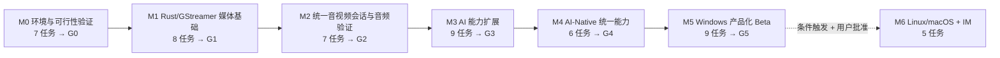

# Shutu AI-Native Media — 开发任务总控计划

> **版本**：v1.1（2026-11-11 验收修订，依据 ADR-011；初版 v1.0 于 2026-11-10 规划）
> **事实来源**：`docs/ARCHITECTURE_BASELINE.md`（架构基线 v1.0，零改动）> 本文件 > 各里程碑任务文档 > AGENTS.md。任何冲突以基线为准。
> **文档族**：本文件（总控）｜`M0_TASKS.md`~`M6_TASKS.md`（任务明细）｜`TASK_DEPENDENCIES.md`（依赖与门禁）｜`ACCEPTANCE_MATRIX.md`（验收矩阵）｜`AGENTS.md`（Agent 执行规则）｜`docs/adr/`（变更决策）｜`docs/tasks/EVIDENCE_SPEC.md`（证据归档规范）。

## 1. 目标与范围声明

本计划将基线 §9 的 M0–M6 里程碑拆解为 **51 项原子任务**（v1.1 起新增 M5-T9，ADR-011），每项含 11 个必填字段（ID 与目标 / FR·ADR 追溯 / 前置依赖 / 文件范围 / 实施步骤 / 自动化测试 / 真实环境验收 / DoD / 风险与失败处理 / 测试证据 / 状态）。

**本次规划（2026-11-10）只建立了任务体系，未实现任何产品功能**。2026-11-11 验收修订（ADR-011，`PLANNING_GATE=GO`）后按门禁纪律开始执行；实时状态以 §3 注册表为准，所有技术结论在对应任务的真实环境验收完成前一律视为「待验证」。

## 2. 里程碑地图与门禁



门禁语义、阻塞规则、任务级依赖表见 `TASK_DEPENDENCIES.md`（以其中 `BLOCKED_BY` 列为机器判读依据）。

## 3. 全量任务注册表（51 项）

> 状态更新规则见 §6。`AUTH` = 需授权门（当前 PENDING：M2-T6、M5-T9、M6-T2 内核分支）。可选任务未授权/未触发时记 `NOT_RUN`（ADR-011 D1），Gate 汇总任务为 AGGREGATE（报告必达，ADR-011 D2）。

| ID | 任务名称 | 前置依赖 | AUTH | 状态 |
|---|---|---|---|---|
| M0-T1 | 环境盘点脚本与工具链补齐 | — | — | 已完成（run G0-20261111-174257-8532） |
| M0-T2 | 官方 VirtualCamera Sample 构建/注册/卸载 | M0-T1 | — | 已完成（run G0-20261111-182351-1DB8） |
| M0-T3 | 双独立应用消费与生命周期验证 | M0-T2 | — | 已完成（run G0-20261113-201619-b4dc；App A 已知缺陷见 run decision.md） |
| M0-T4 | Frame Server 约束验证 + IPC 身份 PoC + R-02 决策 | M0-T2 | — | 已完成（run G0-20261112-191515-3C36） |
| M0-T5 | SysVAD 风险书面评估 | — | — | 已完成（run G0-20261111-212232-D720） |
| M0-T6 | contracts 骨架 + 证据基线设施 + adr 约定 | M0-T1 | — | 已完成（run G0-20261113-153144-57a0） |
| M0-T7 | **G0 Gate 汇总** | M0-T3/T4/T5/T6 | — | 已完成（run G0-20261113-223247-7bc7；**G0=GO 经用户确认 2026-11-13**，M1 解锁） |
| M1-T1 | Rust workspace + threat-model 初版 + SBOM 机制 | G0=GO | — | 已完成（run G1-20261113-230809-9e2c） |
| M1-T2 | testsrc→appsink 基础视频图 | M1-T1 | — | 已完成（run G1-20261114-085728-657b） |
| M1-T3 | 共享内存视频 Ring + 契约测试 | M1-T1 | — | 未开始 |
| M1-T4 | Named Pipe 控制通道 | M1-T1 | — | 未开始 |
| M1-T5 | MediaSource 改 IPC ring 读帧 | M0-T4, M1-T3, M1-T4 | — | 未开始 |
| M1-T6 | 端到端验证 + 多消费者/用户切换/重复装卸 | M1-T2/T3/T4/T5 | — | 未开始 |
| M1-T7 | 物理摄像头输入接入 | M1-T6 | — | 未开始 |
| M1-T8 | **G1 Gate 汇总**（NFR-01/03/07 初步） | M1-T6, M1-T7 | — | 未开始 |
| M2-T1 | Session/Track/Clock/Event/Policy 契约 v0.1 冻结 | G1=GO | — | 未开始 |
| M2-T2 | 物理麦克风捕获 + PCM + 同步测试源 | M2-T1 | — | 未开始 |
| M2-T3 | Track A 音频桥接 + NFR-02 | M2-T2 | — | 未开始 |
| M2-T4 | 音视频同 Session + NFR-04/05 | M2-T3 | — | 未开始 |
| M2-T5 | 鲁棒性矩阵 + 权限撤销（NFR-08 初版） | M2-T4 | — | 未开始 |
| M2-T6 | SysVAD Track B PoC（**可选**） | M0-T5 + 授权 | **AUTH·PENDING** | 未开始（未授权时记 NOT_RUN，不阻塞 G2） |
| M2-T7 | **G2 Gate 汇总** + Track B 显式结论 | M2-T4/T5；M2-T6 终态（AGG） | — | 未开始 |
| M3-T1 | 本地视频效果节点 | G2=GO | — | 未开始 |
| M3-T2 | 本地音频效果节点 | M3-T1 | — | 未开始 |
| M3-T3 | ai-adapter（Manifest/授权/取消/超时/健康/降级） | M3-T1 | — | 未开始 |
| M3-T4 | 本地 VAD/ASR 字幕语义事件 | M3-T3 | — | 未开始 |
| M3-T5 | AI 音频替换 Output Track | M3-T2, M3-T3 | — | 未开始 |
| M3-T6 | 双 Provider A/B harness（NFR-10） | M3-T4 | — | 未开始 |
| M3-T7 | 故障注入 + 撤销 + 安全测试（NFR-06/07/08） | M3-T5, M3-T6 | — | 未开始 |
| M3-T8 | 多 AI 节点串联（FR-004） | M3-T1/T2/T3 | — | 未开始 |
| M3-T9 | **G3 Gate 汇总** | M3-T7, M3-T8 | — | 未开始 |
| M4-T1 | Capability/Policy/Event 契约 v0.2 | G3=GO | — | 未开始 |
| M4-T2 | 稀疏视频采样 + 语义事件 + 防注入 | M4-T1 | — | 未开始 |
| M4-T3 | Generated Video Track + 来源元数据 | M4-T1 | — | 未开始 |
| M4-T4 | A+V 关联时间轴 + 过期帧丢弃 | M4-T2, M4-T3 | — | 未开始 |
| M4-T5 | 「单模型替代多节点」mock 集成测试 | M4-T4 | — | 未开始 |
| M4-T6 | **G4 Gate 汇总** | M4-T5 | — | 未开始 |
| M5-T1 | Control GUI | G4=GO | — | 未开始 |
| M5-T2 | 安装/升级/卸载/回滚 + uninstall-verify | M5-T1 | — | 未开始 |
| M5-T3 | 版本固化/SHA-256/SBOM 封版/签名计划（只成文） | M5-T2 | — | 未开始 |
| M5-T4 | 应用兼容性矩阵 | M5-T2 | — | 未开始 |
| M5-T5 | Release Evidence（NFR-06~09 全量）+ 清洁镜像 | M5-T2 | — | 未开始 |
| M5-T6 | 音频交付形态决策 | M5-T3；M5-T9 终态（AGG） | — | 未开始 |
| M5-T7 | threat-model 完整化 + 安全审查 | M5-T5 | — | 未开始 |
| M5-T8 | **G5 Gate 汇总**（判定声明 L1/L2） | M5-T4/T5/T6/T7；M5-T9 终态（AGG） | — | 未开始 |
| M5-T9 | 执行代码签名/驱动签名（**条件触发**） | M5-T3 + 授权 | **AUTH·PENDING** | 未开始（未触发/未授权时记 NOT_RUN，不阻塞 G5） |
| M6-T1 | OS Adapter 契约评审 v1 | G5=GO + 用户批准 | — | 未开始 |
| M6-T2 | Linux PipeWire spike | M6-T1 + 用户批准 | — | 未开始 |
| M6-T3 | macOS CoreMediaIO/Core Audio spike | M6-T1 + 用户批准 | — | 未开始 |
| M6-T4 | LiveKit/WebRTC 消费者 spike | M6-T1 + 用户批准 | — | 未开始 |
| M6-T5 | AI-Native IM 集成评估报告 | M6-T2/T3/T4 | — | 未开始 |

**状态统计**：未开始 42（M1-T3~T8 及 M2–M6 全部，M1-T3 起依次可启动，M1-T3 执行前须先处理与 ADR-012 的修订评审——见 M1-T1 run decision.md §5）｜ 进行中 0 ｜ 已完成 9（M0-T1~T7 + M1-T1~T2）｜ 门禁：**G0=GO（2026-11-13 用户确认）**，M2–M6 BLOCKED（G1–G5 未 GO）｜ AUTH·PENDING（不阻塞主线 Gate）M2-T6、M5-T9——未授权时记 NOT_RUN（ADR-011）。

## 4. 当前环境登记（2026-11-10 规划期探测；2026-11-11 工具链补齐后更新）

> 正式来源以 M0-T1 生成的 `environment.json` 为准；下表为规划期快照，供 M0-T1 对照。
> **探测误报修正（2026-11-11）**：早前「VS C++ 工具链未检测到」系 vswhere 探测参数错误导致的**误报**——本机实际存在 VS 2022 与 VS 2026 两套完整 BuildTools（cl.exe 编译验证可用）。该修正作为环境探测方法论教训记入 M0-T1 参考输入。

**已具备**：

| 项 | 值 | 满足的门槛 |
|---|---|---|
| OS | Windows 11 家庭中文版 25H2，Build 26200.9711 | ≥22000（MFCreateVirtualCamera 门槛，§2.1）✅ |
| git | 2.56.0.windows.4 | 版本控制 ✅ |
| Rust | 1.95.0（msvc host，2026-11-11 链接验证通过） | ADR-001 工具链 ✅ |
| Windows SDK | 10.0.26100.0 / 10.0.22621.0 | VirtualCamera Sample 构建 ✅ |
| VS C++ 工具链 | VS 2022 BuildTools 17.14（MSVC v143 14.44）+ VS 2026 BuildTools 18.9（v145）+ CMake 4.2.3（2026-11-11 确认，探测误报修正） | M0-T2 C++ 编译、Rust msvc 链接 ✅ |
| GStreamer | 1.28.3 MSVC x86_64（`C:\gstreamer\1.0\msvc_x86_64`，2026-11-11 经用户确认安装，SHA256 校验通过） | M1-T2 起管线任务 ✅ |
| Python | 3.14.7 | 可选外部 Worker（§6.2）预留 ✅ |
| 硬件 | Intel Ultra 7 255H / Arc 140T 16GB / 31.4GB RAM / 298GB 可用 | 满足开发与 CPU 基线 ✅ |

**缺口（M0-T1 处理）**：

| 缺口 | 影响 | 处置 |
|---|---|---|
| WDK 未安装 | 仅影响 Track B（M2-T6） | 符合预期：不装；驱动工作仅在授权隔离测试机（本机为家庭版，不承担驱动测试签名） |
| 无第二台隔离驱动测试机（待确认） | M2-T6 只能 HOLD；Track B 书面推进 | M0-T1 探测确认；M0-T5 输出测试机策略 |
| 待现场确认项 | 物理摄像头/麦克风在位性与隐私权限、GPU 驱动版本（R-07）、安全软件/VPN/管控（R-11）、多用户账户可建性（§5.1-7） | 全部记入 `environment.json`（M0-T1） |

## 5. 执行规则（浓缩；完整版见 AGENTS.md）

1. **只做当前 Gate 的任务**：G(k) 未 GO 之前，M(k+1) 全部任务 BLOCKED；跨 Gate 改动须书面理由（§14.1）。
2. **选择任务**：按 `TASK_DEPENDENCIES.md` 任务边表，选 `BLOCKED_BY` 全部满足且非 AUTH-PENDING 的任务。
3. **执行与证据**：按任务文档 11 字段执行；证据写入 `artifacts/<gate>/<run-id>/`（九文件，§10.3）；**Mock/CI 通过 ≠ 真机验证**。
4. **授权红线**：驱动安装、测试签名、安全策略变化一律走 `AUTH_REQUIRED` 登记表；PENDING 不得启动（§14.1、ADR-004）。
5. **汇报（AGGREGATE，报告必达）**：每个 Gate 汇总任务在上游到达任意终态（已完成/HOLD/STOP/BLOCKED/NOT_RUN）时**必须产出** §14.2 十字段报告；`STATUS=GO ⇔ 全部强制条件通过`，判定经用户确认；G5 = GO 必须声明交付等级 `GO(LEVEL=L1|L2)`（ADR-011 D2/D4）。
6. **SYS_CHANGE**：虚拟设备注册/注销、系统服务安装/重启、开发工具安装、PATH/环境变量修改，执行前须向用户单次确认（操作内容、影响范围、回滚方法），并写入该 run `decision.md` 的 `system_changes[]` 与 `environment.json` 增量（ADR-011 D6）；驱动安装/测试签名/安全策略变化仍走 AUTH_REQUIRED，不降级。
7. **变更控制**：改三平面边界、contracts 协议、OS Adapter 策略、音频签名策略 ⇒ 新 ADR（§14.3）；性能数字只在固定硬件与方法下调整，原始 benchmark 不删除。
8. **禁止编造**：FPS、时延、编译成功、驱动签名、安装与兼容性证明一律以留存证据为准（§14.1）。

## 6. 状态更新规则

- 任务状态取值：`未开始 → 进行中 → 已完成 / BLOCKED / HOLD / NOT_RUN`。可选任务未授权/未触发时记 `NOT_RUN`（ADR-011 D1，须在对应 run 的 decision.md 记录原因与复评触发条件）；Gate 汇总任务可在上游非完成终态下产出 HOLD/STOP 报告（ADR-011 D2）；只有**汇总 Gate 任务与用户确认**能把整个里程碑置为通过。
- 置「已完成」须同时满足：① 11 字段中 DoD 全部达成；② 证据文件已存在并标注 run-id；③ 无越 Gate 改动；④ 自动化测试全绿。
- 真实环境验收未完成时，自动化部分最多记「进行中（CI 已过，真机待验）」，**不得记已完成**。
- 状态修改必须在任务文档「状态」行与本文 §3 注册表同步更新，并在文末变更记录追加一行（不得覆盖历史）。

## 7. 文档相互关系

```
ARCHITECTURE_BASELINE.md（唯一事实来源）
   │  追溯
   ├── docs/tasks/MASTER_TASK_PLAN.md（本文件：注册表 + 状态 + 规则）
   ├── docs/tasks/M0~M6_TASKS.md（任务明细，11 字段/项）
   ├── docs/tasks/TASK_DEPENDENCIES.md（门禁 + BLOCKED_BY + AUTH 登记表）
   ├── docs/tasks/ACCEPTANCE_MATRIX.md（FR/NFR/R/§15 × 任务 × 证据）
   ├── docs/tasks/EVIDENCE_SPEC.md（证据索引与归档规范，ADR-011 D5）
   └── AGENTS.md（Agent 执行规则浓缩）
```

## 8. 变更记录

| 日期 | 版本 | 变更 | 依据 |
|---|---|---|---|
| 2026-11-10 | v1.0 | 初版：50 项任务（M0:7/M1:8/M2:7/M3:9/M4:6/M5:8/M6:5）、G0–G5 门禁体系、验收矩阵、AGENTS.md | 架构基线 v1.0 + 用户任务规划指令 |
| 2026-11-11 | v1.1 | 验收修复（ADR-011）：M2-T6 改可选+NOT_RUN 不阻塞 G2；六个 Gate 任务 AGGREGATE 化（报告必达）；M5-T3/M5-T9 拆分（任务总数 50→51）；G5 双交付等级 GO(LEVEL=L1/L2)；新增 EVIDENCE_SPEC 证据索引归档规范；新增 SYS_CHANGE 系统状态变更确认机制；环境表补齐 VS 工具链/GStreamer 并记录探测误报修正 | ADR-011 + 用户验收指令（架构基线 v1.0 零改动） |
| 2026-11-11 | 状态变更 | M0-T1 未开始 → **已完成**（run G0-20261111-174257-8532）：verify-environment v1.0 + schema + 自测 5/5 + 幂等 YES；environment.json 真机生成（Build 26200.9974）；工具链实测落档；WDK 记录不安装原因；docs/platform-windows.md 快照；一致性检查 38/38 | M0_TASKS DoD 四条 + MASTER §6 规则 + EVIDENCE_SPEC |
| 2026-11-11 | 状态变更 | M0-T2 未开始 → **已完成**（run G0-20261111-182351-1DB8）：官方 Windows-Camera Sample 原样构建（commit 626f8b19，MIT，SBOM 0.2 五新增条目）；3 轮注册→拉流（TestVCam 30 帧校验×3）→Windows Camera 合成画面像素级留证→注销循环全通过，设备实例 ID 逐轮一致；完整回滚（/Uninstall + COM 键删 + 目录删 + Frame Server DLL 缓存处置）终态断言 ABSENT/COM=no；SYS_CHANGE 台账 3 项均经用户确认；偏差（BuildTools 无 VS IDE→MSI 不可构建，README 键 + 官方 Installer 控制台替代）记 run decision.md §3；复现文档 `platforms/windows/virtual-camera/README.md` | M0_TASKS M0-T2 DoD + AGENTS §3 SYS_CHANGE + 基线 §14.1/§14.3（无 ADR 级边界触碰） |
| 2026-11-11 | 状态变更 | M0-T5 未开始 → **已完成**（run G0-20261111-212232-D720）：纯书面研究（无构建/安装/系统变更，task 定义禁止）；①WDK/EWDK 版本矩阵（28000.2526 配 VS 2026 / 26100.6584 配 VS 2022 / EWDK 独立许可）+ SysVAD 构建条件（main 需 v142 工具集 + WIL submodule——本机仅 v143/v145，缺口书面确认）；②签名四路径矩阵（HLK/attestation/preproduction/test；原样 sample 有 HLK 预期失败项 ⇒ 不可直接提交；本机永不测试签名）；③硬边界写入 platform-windows.md §6；④测试机 unconfirmed 保持 ⇒ Track B HOLD + 复评三触发条件；⑤Track A 三候选许可/分发（VB-Cable/VoiceMeeter Donationware+Volume Licensing、VAC 商业 $30/$50+custom version 捆绑通道，**不默认随产品捆绑**）；⑥GO/HOLD 触发条件 + Track A/B 边界声明。产出：run decision.md（官方引用 10 项，访问日期 2026-11-11）+ licensing-sbom.json 0.3（6 条 research-only）+ docs/licensing.md v0.1（新建）| M0_TASKS M0-T5 DoD + AGENTS §6（SBOM）+ 基线 §2.2/§14.1（书面任务，全部未实测判断标「待实测确认」） |
| 2026-11-13 | 状态变更 | M0-T4 未开始 → **已完成**（run G0-20261112-191515-3C36）：Frame Server 真机事实 F1-F11（LocalService S-1-5-19、运行中 Session 0、完全按需启停、SCM 7036 不记录启停、提权模块表确认 VirtualCameraMediaSource.dll 加载、sdshow 交互用户仅查询权限）；最小 IPC 身份 PoC（源码入库 `tests/contract/ipc-identity-poc/`，cl /O2 /W4 exit 0）12 项矩阵 11 pass / 1 partial=T5（LS 可 OS 级连接用户 DACL 授权管道⇒跨会话连通可行；但服务端 OpenProcess→token 跨会话查询失败⇒进程级身份校验不可行→fail-closed 生效）；T7b 实测否定基线 §5.1 共享内存用户侧前提（用户不能建 Global\ section），T7a 反向可行；SC#3 服务重启 0s 恢复 + 30 帧验证；多用户同账户双会话 29/30 帧；SYS_CHANGE 3 项均经用户确认并完整回滚（ABSENT OK count=0、计划任务已删、Temp/Public 清理）；**R-02=GO**：Named Pipe 首选（帧随控制通道，吞吐留 M1-T4/T5 实测）、LS broker Global section 备选（需新 ADR）、管道 DACL=OS 身份边界五条写入 M1-T4/T5 约束，待 M0-T6 后以首个 ADR 正式化（涉及基线 §5.1 调整，基线 §14.3）；perf.json N/A（无性能验收指标，不伪造数据）；K1-K7 未验证项记 run decision.md §7；一致性检查 38/38 | M0_TASKS M0-T4 DoD + AGENTS §2/§3/§4/§8 + 基线 §5.1/§12/§14.2（R-02 为 G0 GO 前置条件） |
| 2026-11-13 | 状态变更 | M0-T6 未开始 → **已完成**（run G0-20261113-153144-57a0）：contracts/ 三子目录占位 README（冻结流程+版本承诺，无协议字段）；tools/collect-evidence v1.0（init/manifest/validate/verify/--selftest，stdlib-only，EVIDENCE_SPEC §2 生成器；字节级幂等；init 拒绝已存在 run；selftest 16/16 + CLI 场景 9/9）；docs/adr/ 机制补齐（README 编号/生命周期/触发条件清单 + TEMPLATE；ADR-011 已在库 ⇒ 编号检查后新 ADR=ADR-012）；**ADR-012**（R-02 正式化 CONDITIONAL_GO：Named Pipe 控制通道 Accepted；帧承载=管道复用首选、是否保留由 M1-T4/T5 实测（P1-3）决定、未实测达标不得标记生产可用；七条安全设计要求 S1-S7——LocalService SID 非专属/最小 DACL/防远程与抢占/双向认证与多用户隔离/PoC 异步取消风险（禁止复制）/吞吐理论与验证条件/共享内存备选启用条件；新实测事实 V7=FrameServer SERVICE_SID_TYPE UNRESTRICTED + per-service SID）；docs/TECH_DEBT.md 新建（P1-1/P1-2/P1-3 正式登记，OPEN，未完成验证不得 CLOSED，责任任务 M1-T4/M1-T5）；M1-T4/T5 字段挂接技术债；基线文件零改动（§5.1 修订记录于 ADR-012 §5，升级留基线评审）；零系统状态变更（SYS_CHANGE=[]）；偏差 3 项记 run decision.md §3 | M0_TASKS M0-T6 DoD + AGENTS §9（ADR 模板与变更控制）+ 基线 §14.3 + 用户 M0-T6 指令（含 P1 闭环要求） |
| 2026-11-13 | 状态变更 | M0-T3 未开始 → **已完成**（run G0-20261113-201619-b4dc，复用 M0-T2 构建产物 SHA-256 一致）：双独立应用消费矩阵完成——**应用 B（Chrome 157.0.8103.51，getUserMedia 测试页 `tests/fixtures/getusermedia/` + 本地控制服务）全路径 PASS**（独立渲染 640x480@30 合成帧、与相机应用经同一 Frame Server 并发（不同设备变体）无干扰、Stop/Start（track 停止 1ms / FS 拆除 ~36s / 重建 225ms / FS 冷启 0.6s）、使用中移除即 track ENDED 0 错误、重注册**不自动恢复需手动重开**（实测确认）、前台化帧数证据 1861@fps123.3）；**应用 A（Windows 相机 2026.2608.1.0）FAIL（稳定消费能力）**——收口逐图审计修正判定语义（§2a）：首次渲染合成帧成功（pos0/2/4 截图），但摄像头切换间歇抛 0xA00F4241<CameraSwitchFailed> 且错误态持久不可自愈（重启/SE 排查/FS 重启均无效），TestVCam 同日通过 ⇒ 应用侧问题，作 R-03/R-12 设计输入（任务字段 9 规定非 M0 失败条件）；真·同设备并发 N/A（A 侧阻断）如实记录；生命周期 A1→B2→A3→B4 四轮循环实例 ID 确定性一致无残留；终态断言设备 ABSENT + COM=no + 目录已删（sc stop frameserver 释放 DLL 缓存）；SYS_CHANGE 10 次 UAC 全部逐项批准（SC-1~SC-6 台账 + 回滚闭环）；偏差 D1-D13 记 run decision.md（含证据命名失准 2 处收口审计发现与修正、遮挡窗口 rVFC 停摆方法学、Chrome 中途自动更新）；证据九文件齐全 + manifest 86 文件 INTEGRITY-OK + 人工审计（4 张含真实场景 media_content=true 30 天保留）；docs/platform-windows.md §8 落档；一致性检查 38/38 | M0_TASKS M0-T3 DoD + AGENTS §3/§4/§8 + 任务字段 9（互斥/失败事实非 M0 失败条件）+ 基线 §10.2/§14.1 |
| 2026-11-13 | 状态变更 | M0-T7 未开始 → **进行中**（run G0-20261113-223247-7bc7）：G0 Gate 汇总审计执行——①六任务六 run 审计链勾稽（8532/1DB8/D720/3C36/57a0/b4dc ↔ 21035c8/22397a0/377e5d5/5353c17/eb7286c/6ee14bd 全部在 git 历史验证）；②collect-evidence verify 全覆盖（工具 RUNID_RE 大写 hex 修复，selftest 16/16；5 run INTEGRITY-OK，b4dc 经前缀哈希纯追加证明 + 用户授权终止遗留轮询器后固化）；③manifest 修复台账 5 run（就地修订保留手写 description，未用工具重建——build_manifest 会重置逐文件元数据）；④逐截图人工复核 11 张（首帧活帧相位/D13 误名勘误/4 张 media_content=true 保留期 2026-12-13）；⑤门审时点终态断言（VCAMDEVAPI=0、CLSID {7B89B92E-…} ABSENT、目录 ABSENT、FrameServer STOPPED）；⑥G0 九项强制条件判定 + 摄像头缺陷四能力分列裁定（KI-G0-1 切换失败/ KI-G0-2 同设备并发 NOT_VERIFIED 登记为独立已知缺陷，G1 责任任务与闭环条件显式化）；⑦状态一致性修复（本表统计 5→6 已完成补 M0-T3；M0_TASKS 概览 M0-T5 状态单元同步）。**GATE=G0 判定建议=GO 候选（待用户确认，AGENTS §9）**；确认后置已完成并解锁/维持 M1 BLOCKED 决策 | 用户 M0-T7 Gate 验收指令 + AGENTS §2/§9 + 基线 §9/§14.2 + ADR-011/012 + EVIDENCE_SPEC |
| 2026-11-13 | 状态变更 | M0-T7 进行中 → **已完成**；**G0=GO 正式生效（用户确认，AGENTS §9），M1 解锁**：①b4dc 遗留轮询器经用户会话内终止（22:47，Git Bash /F 转义修正后执行），log 终态 393,570B 固化，manifest 更新 + verify → **七 run 全部 INTEGRITY-OK（7/7）**；②§14.2 十字段报告交付（STATUS=GO 候选：上游 61 项 59 pass/1 fail/1 partial + 门审 9 项全 PASS；九项强制条件全 PASS；无不可解释证据冲突）；③用户确认后执行：M0-T7 置已完成、状态统计（已完成 7、M1 解锁、M2–M6 保持 BLOCKED）、**M1-T6 字段挂接 KI-G0-1/KI-G0-2 强制闭环项（字段 1+8）**、platform-windows.md §8.3 补 L-1（staging 脚本停止条件教训）、EVIDENCE_INDEX 行更新；④一致性检查 38/38 | 基线 §9/§14.2 + AGENTS §9（用户确认先行）+ run G0-20261113-223247-7bc7 decision.md §9/§10 |
| 2026-11-13 | 状态变更 | M1-T1 未开始 → **已完成**（run G1-20261113-230809-9e2c，M1 首任务）：Rust workspace 三 crate（media-core 零依赖 / gst-adapter / device-bridge，依赖方向单向 gst-adapter·device-bridge→media-core，workspace lints unsafe_code=forbid + clippy unwrap/expect_used=warn）；gstreamer-rs 0.25.4 真实 MSVC 链接验证（pkg-config 0.29.2 用 GStreamer SDK 1.28.3 自带 exe，零安装 SYS_CHANGE=[]；测试真实加载 DLL 版本≥1.24 断言 + videotestsrc 注册表扫描 + gst-launch 管线 exit 0）；本地 CI `scripts/ci.ps1`（fmt-check + clippy -D warnings + test 全绿，clippy 抓出 1 处测试缺陷修复后过——CI 有效性正面证据）；ADR-012 类型守卫测试（TransportPolicy::ADR012_DEFAULT 管道首选无实测背书）；threat-model.md v0.1（六信任边界 B1-B6 + 隐私映射）；SBOM v0.4 滚动机制（4 新条目 + Cargo.lock 59 包闭包权威，全 MIT/MIT OR Apache-2.0）；偏差 D-1：kstring pin 2.0.2（2.0.4+ 需 rustc≥1.96 > 本机 1.95）；**M1-T3 与 ADR-012 顺序冲突仅提修订建议（方案 A 顺序对调 / 方案 B 重定义承载抽象）不擅改任务文档与基线**（约束 6）；P1-1/2/3 与 KI-G0-1/2 OPEN 保持；已知限制：GitHub Actions CI 未接入（字段 5 仅要求本地 CI，如实记录）；manifest 9 文件 INTEGRITY-OK；一致性检查 38/38 | M1_TASKS M1-T1 DoD + AGENTS §6/§7 + 基线 §3.4/§8/§13 + ADR-012 + 用户 M1 启动指令（含约束 1-6 与 push 授权） |
| 2026-11-14 | 状态变更 | M1-T2 未开始 → **已完成**（run G1-20261114-085728-657b）：进程内视频测试管线（`videotestsrc(is-live, smpte 静态彩条)→videoconvert→capsfilter(NV12 1280x720@30 固定)→queue(4条/8MiB/500ms+leaky=downstream)→appsink(2条+drop)`，CREATED/PLAYING/STOPPED/ERROR 四态 + 限时等待全 API）；**caps 决策记录入库 contracts/media/README.md**（NV12 四条理由 + 实测布局 stride=[1280,1280]/offsets=[0,921600]/map=1,382,400）；帧元数据（seq/PTS/duration/格式/平面/stride/offset/接收双时钟源/首段哈希）+ 指标快照 API；测试 29/29 CI GREEN（含新建 tests/integration/ 10 项：T1-T10 逐项映射指令要求）+ **perf.json 实测**（快消费 10s 299 帧@29.978fps 零丢帧零违例积压峰值 1；慢消费 200ms/帧 → 146 overrun 积压封顶 4=上限——内存有界实证；T9 确定性构图哈希跨启动一致）；开发缺陷 4 项测试抓出修复（**PTS 单调性跨周期假报 → 运行内不变量语义**、guint 属性类型、duration min 初值、clippy 三项）；SBOM v0.5（+8 包全 MIT 系，闭包 68 包）；media-core 零改动（管线以 FramePolicy 为输入——解耦实证）；证据级别显式声明：**进程内 GStreamer 测试 = CI 级证据，非 OS 虚拟摄像头验证**（AGENTS §4）；SYS_CHANGE=[]；一致性检查 38/38 | M1_TASKS M1-T2 DoD + AGENTS §3/§4/§5/§6 + 基线 §3.4/§4.4/§11-5 + 用户 M1-T2 指令（测试要求 1-8 / 架构边界 6 条 / push 授权） |
