# 任务依赖关系与门禁阻塞规则

> **来源**：`docs/ARCHITECTURE_BASELINE.md` §9（里程碑与门禁）、§14.1/14.2（执行规则与汇报）。共 **50 项任务**（M0:7 / M1:8 / M2:7 / M3:9 / M4:6 / M5:8 / M6:5）。
> **机器判读优先**：执行 Agent 应以本文「任务边表」的 `BLOCKED_BY` 列为准选择可执行任务；Mermaid 图仅为可视化辅助。

## 0. 全局阻塞规则（先读）

1. **门禁阻塞**：`G(k) ≠ GO ⇒ 里程碑 M(k+1) 的全部任务状态 = BLOCKED`。**HOLD 与 STOP 同样阻塞下游**（HOLD ≠ 可继续）。
2. **授权阻塞**：`AUTH_REQUIRED` 且状态 `PENDING ⇒ 该任务不得启动`，无论其他依赖是否满足。
3. **证据阻塞**：任务完成后若其「所需证据文件」缺失，后续依赖任务在选任务时视其为未完成。
4. **跨 Gate 改动**：需要修改非当前 Gate 的模块时，必须先给出书面理由（§14.1），否则不得执行。

---

## 1. Gate 边（G0–G5）

| Gate | 验收原文（§9 摘录） | 汇总任务 | GO 语义 | HOLD/STOP 语义 |
|---|---|---|---|---|
| **G0** | camera synthetic works；实际测试程序、Windows Build、安装和卸载步骤可重复；SysVAD 风险已形成书面判断。**若摄像头样例均失败，STOP** | M0-T7 | 解锁全部 M1 任务 | HOLD/STOP ⇒ M1 全部 BLOCKED；STOP 时先排除工具链/环境再写引擎 |
| **G1** | Windows Camera 与第二款应用持续使用 30 分钟；AI 为 0 依赖；Runtime 杀进程后设备不崩溃并进入安全备用画面；队列有界 | M1-T8 | 解锁全部 M2 任务 | ⇒ M2 全部 BLOCKED |
| **G2** | 音频及视频在同一 Session 可运作；音频桥接清楚标识非自研驱动；同步与恢复指标有证据；SysVAD PoC 给出 GO/HOLD/STOP | M2-T7 | 解锁全部 M3 任务 | ⇒ M3 全部 BLOCKED；Track B 结论独立记录，不与 Camera 混淆 |
| **G3** | AI on/off 以及 Provider A/B 切换后 OS 设备正常；Kill AI Worker 后 G1/G2 的非 AI 基线仍通过 | M3-T9 | 解锁全部 M4 任务 | ⇒ M4 全部 BLOCKED |
| **G4** | 模型路径从模块组合切换到端到端模型模拟，虚拟摄像头/麦克风接口和既有应用无需改动；A/V 相关事件时间戳可追踪 | M4-T6 | 解锁全部 M5 任务 | ⇒ M5 全部 BLOCKED |
| **G5** | 没有 P0 缺陷；无未授权媒体上传；可干净卸载；技术债、签名状态和支持应用清单清晰。若虚拟麦克风签名与兼容性未达标，禁止声称完整交付 | M5-T8 | M6 按条件触发评估 | ⇒ M6 全部 BLOCKED；§15.2 不满足时只能以受限/实验版名义交付 |

**每个 Gate 的汇报必须使用基线 §14.2 十字段模板**：`GATE / STATUS / IMPLEMENTED / TESTS / OS_EVIDENCE / PERFORMANCE / SECURITY / LICENSING / KNOWN_ISSUES / NEXT_GATE`。机器无法测试 OS 设备时必须给 HOLD，不能用 Mock / Linux CI 替代 Windows 设备验证。

---

## 2. 任务边表（BLOCKED_BY 为准）

> 类型：`TASK_DEP` = 普通任务依赖；`AUTH` = 另需授权门。工作环境：`主力开发机` = 本 Windows 开发机；`隔离测试机` = 专用驱动测试机（M0-T5 定策略）。

### M0（G0）

| ID | 任务 | BLOCKED_BY | 类型 | 所需证据文件 | 工作环境 |
|---|---|---|---|---|---|
| M0-T1 | 环境盘点与工具链补齐 | — | TASK_DEP | environment.json, build.log, licensing-sbom.json | 主力开发机 |
| M0-T2 | 官方 Sample 构建/注册/卸载 | M0-T1 | TASK_DEP | build.log, device-enumeration.txt, screenshots, test-results.json, licensing-sbom.json | 主力开发机 |
| M0-T3 | 双应用消费验证 | M0-T2 | TASK_DEP | device-enumeration.txt, screenshots, test-results.json | 主力开发机 |
| M0-T4 | Frame Server 约束 + IPC 身份 PoC + R-02 决策 | M0-T2 | TASK_DEP | environment.json(补), screenshots, security-checklist.md, test-results.json, decision.md | 主力开发机 |
| M0-T5 | SysVAD 风险书面评估 | — | TASK_DEP | decision.md, licensing-sbom.json | 书面研究（无环境操作；升级为构建/安装时须 AUTH） |
| M0-T6 | contracts 骨架 + 证据设施 | M0-T1 | TASK_DEP | test-results.json, build.log | 主力开发机 |
| M0-T7 | **G0 Gate 汇总** | M0-T3, M0-T4, M0-T5, M0-T6 | TASK_DEP | 全套九文件 | 主力开发机 |

### M1（G1；全部 BLOCKED_BY G0=GO）

| ID | 任务 | BLOCKED_BY | 类型 | 所需证据文件 | 工作环境 |
|---|---|---|---|---|---|
| M1-T1 | Rust workspace + threat-model 初版 + SBOM 机制 | G0=GO | TASK_DEP | build.log, test-results.json, licensing-sbom.json | 主力开发机 |
| M1-T2 | testsrc→appsink 基础视频图 | M1-T1 | TASK_DEP | test-results.json, perf.json | 主力开发机 |
| M1-T3 | 共享内存视频 Ring + 契约测试 | M1-T1 | TASK_DEP | test-results.json, contracts/ipc/v0.1 | 主力开发机 |
| M1-T4 | Named Pipe 控制通道 | M1-T1 | TASK_DEP | test-results.json, security-checklist.md, contracts/ipc/control-v0.1 | 主力开发机 |
| M1-T5 | MediaSource 改 IPC ring 读帧 | M0-T4, M1-T3, M1-T4 | TASK_DEP | build.log, test-results.json, screenshots, device-enumeration.txt | 主力开发机 |
| M1-T6 | 端到端 + 多消费者/用户切换/重复装卸 | M1-T2, M1-T3, M1-T4, M1-T5 | TASK_DEP | perf.json, test-results.json, device-enumeration.txt, screenshots, 故障注入日志 | 主力开发机 |
| M1-T7 | 物理摄像头输入接入 | M1-T6 | TASK_DEP | perf.json, test-results.json, screenshots, environment.json(设备段) | 主力开发机 |
| M1-T8 | **G1 Gate 汇总**（NFR-01/03/07 初步） | M1-T6, M1-T7 | TASK_DEP | 全套九文件（perf.json 含 30min 采样） | 主力开发机 |

### M2（G2；全部 BLOCKED_BY G1=GO）

| ID | 任务 | BLOCKED_BY | 类型 | 所需证据文件 | 工作环境 |
|---|---|---|---|---|---|
| M2-T1 | 契约 v0.1 冻结 | G1=GO | TASK_DEP | test-results.json, contracts/media/v0.1 | 主力开发机 |
| M2-T2 | 物理麦克风捕获 + 同步测试源 | M2-T1 | TASK_DEP | perf.json, test-results.json, environment.json | 主力开发机 |
| M2-T3 | Track A 音频桥接 + NFR-02 | M2-T2 | TASK_DEP | perf.json, test-results.json, screenshots, licensing-sbom.json, device-enumeration.txt | 主力开发机 |
| M2-T4 | 音视频同 Session + NFR-04/05 | M2-T3 | TASK_DEP | perf.json, test-results.json, environment.json | 主力开发机 |
| M2-T5 | 鲁棒性矩阵 + 权限撤销（NFR-08 初版） | M2-T4 | TASK_DEP | test-results.json, 恢复时序日志, screenshots, security-checklist.md | 主力开发机 |
| M2-T6 | SysVAD Track B PoC | M0-T5；**AUTH** | **AUTH** | environment.json(测试机), build.log, device-enumeration.txt, screenshots, decision.md | **隔离测试机** |
| M2-T7 | **G2 Gate 汇总** | M2-T4, M2-T5, M2-T6 | TASK_DEP | 全套九文件 + trackB 子集 | 主力开发机 |

### M3（G3；全部 BLOCKED_BY G2=GO）

| ID | 任务 | BLOCKED_BY | 类型 | 所需证据文件 | 工作环境 |
|---|---|---|---|---|---|
| M3-T1 | 本地视频效果节点 | G2=GO | TASK_DEP | test-results.json, perf.json, screenshots | 主力开发机 |
| M3-T2 | 本地音频效果节点 | M3-T1 | TASK_DEP | test-results.json, perf.json, licensing-sbom.json | 主力开发机 |
| M3-T3 | ai-adapter（Manifest/授权/取消/超时/健康/降级） | M3-T1 | TASK_DEP | test-results.json, contracts/capability/, build.log | 主力开发机 |
| M3-T4 | 本地 VAD/ASR 字幕语义事件 | M3-T3 | TASK_DEP | test-results.json, perf.json, licensing-sbom.json | 主力开发机 |
| M3-T5 | AI 音频替换 Output Track | M3-T2, M3-T3 | TASK_DEP | test-results.json, perf.json, 录制样本, security-checklist.md | 主力开发机 |
| M3-T6 | 双 Provider A/B harness（NFR-10） | M3-T4 | TASK_DEP | perf.json, test-results.json, environment.json | 主力开发机 |
| M3-T7 | 故障注入 + 撤销 + 安全测试（NFR-06/07/08） | M3-T5, M3-T6 | TASK_DEP | perf.json, test-results.json, security-checklist.md, 网络/文件追踪 | 主力开发机 |
| M3-T8 | 多 AI 节点串联（FR-004） | M3-T1, M3-T2, M3-T3 | TASK_DEP | perf.json, test-results.json | 主力开发机 |
| M3-T9 | **G3 Gate 汇总** | M3-T7, M3-T8 | TASK_DEP | 全套九文件 | 主力开发机 |

### M4（G4；全部 BLOCKED_BY G3=GO）

| ID | 任务 | BLOCKED_BY | 类型 | 所需证据文件 | 工作环境 |
|---|---|---|---|---|---|
| M4-T1 | 契约 v0.2（音视频联合） | G3=GO | TASK_DEP | test-results.json, contracts/ v0.2, docs/adr/000X | 主力开发机 |
| M4-T2 | 稀疏采样 + 语义事件 + 防注入 | M4-T1 | TASK_DEP | test-results.json, perf.json, security-checklist.md, threat-model 更新 | 主力开发机 |
| M4-T3 | Generated Video Track + 来源元数据 | M4-T1 | TASK_DEP | test-results.json, screenshots, security-checklist.md | 主力开发机 |
| M4-T4 | A+V 关联时间轴 + 过期帧丢弃 | M4-T2, M4-T3 | TASK_DEP | perf.json, test-results.json, trace 记录 | 主力开发机 |
| M4-T5 | 单模型替代多节点 mock 集成测试 | M4-T4 | TASK_DEP | test-results.json, 零改动 diff 证据, screenshots, perf.json | 主力开发机 |
| M4-T6 | **G4 Gate 汇总** | M4-T5 | TASK_DEP | 全套九文件 | 主力开发机 |

### M5（G5；全部 BLOCKED_BY G4=GO）

| ID | 任务 | BLOCKED_BY | 类型 | 所需证据文件 | 工作环境 |
|---|---|---|---|---|---|
| M5-T1 | Control GUI | G4=GO | TASK_DEP | test-results.json, screenshots, build.log, licensing-sbom.json | 主力开发机 |
| M5-T2 | 安装/升级/卸载/回滚 + uninstall-verify | M5-T1 | TASK_DEP | build.log, test-results.json, uninstall-verify 报告, screenshots | 主力开发机 |
| M5-T3 | 版本固化/SHA-256/SBOM 封版/签名计划 | M5-T2 | **AUTH**（签名子项） | SHA256SUMS, licensing-sbom.json(封版), decision.md | 主力开发机 |
| M5-T4 | 兼容性矩阵 | M5-T2 | TASK_DEP | compatibility-matrix.md, test-results.json, screenshots, device-enumeration.txt | 主力开发机 |
| M5-T5 | Release Evidence（NFR-06~09 全量）+ 清洁镜像 | M5-T2 | TASK_DEP | perf.json, test-results.json, 时序日志, 清洁镜像报告, screenshots | 主力开发机 + 独立安装环境 |
| M5-T6 | 音频交付形态决策 | M5-T3 | TASK_DEP | decision.md, 判定表输出 | 主力开发机 |
| M5-T7 | threat-model 完整化 + 安全审查 | M5-T5 | TASK_DEP | threat-model.md, security-checklist.md, test-results.json | 主力开发机 |
| M5-T8 | **G5 Gate 汇总** | M5-T4, M5-T5, M5-T6, M5-T7 | TASK_DEP | 全套九文件 + 定稿文档集 | 主力开发机 |

### M6（后续；全部 BLOCKED_BY G5=GO + 用户批准）

| ID | 任务 | BLOCKED_BY | 类型 | 所需证据文件 | 工作环境 |
|---|---|---|---|---|---|
| M6-T1 | OS Adapter 契约评审 v1 | G5=GO；用户批准 | TASK_DEP | 评审记录, docs/adr/000X, test-results.json | 主力开发机 |
| M6-T2 | Linux PipeWire spike | M6-T1；用户批准 | TASK_DEP | artifacts/M6/, spike 报告, decision.md | Linux 测试环境 |
| M6-T3 | macOS CoreMediaIO/Core Audio spike | M6-T1；用户批准 | TASK_DEP | artifacts/M6/, spike 报告, decision.md | **真实 macOS 硬件** |
| M6-T4 | LiveKit/WebRTC 消费者 spike | M6-T1；用户批准 | TASK_DEP | artifacts/M6/, 录制样本, licensing-sbom.json | 主力开发机 + 自托管服务 |
| M6-T5 | AI-Native IM 集成评估报告 | M6-T2, M6-T3, M6-T4 | TASK_DEP | 评估报告, 契约草案, decision.md | 主力开发机 |

---

## 3. 授权门登记表（AUTH_REQUIRED）

> 规则（§14.1、ADR-004）：涉及驱动安装、测试签名、安全策略变化的任务必须先取得用户**显式授权**。`PENDING ⇒ 不得启动`。授权动作本身必须留痕（追加登记行，不得覆盖历史）。

| 任务 | 授权内容 | 当前状态 | 授权前置条件 | 授权记录 |
|---|---|---|---|---|
| M0-T5 | （仅书面研究；**不涉及**驱动安装——若未来升级为构建任务则须另行授权） | 无需授权即可执行书面部分 | 无 | — |
| M2-T6 | 在隔离测试机上启用测试签名并安装 SysVAD 衍生驱动 | **PENDING** | ① M0-T5 风险结论完成 ② 专用隔离测试机到位 ③ 用户书面批准 | — |
| M5-T3 | 执行代码签名/驱动签名操作 | **PENDING** | ① 签名计划文档评审通过 ② 用户批准（含证书采购决策） | — |
| M6-T2（内核模块分支） | V4L2 loopback 等 DKMS 内核模块安装（如选择该路径） | **PENDING** | Linux 测试环境所有者批准 | — |

**硬边界重申**（基线 §2.2 / ADR-004）：不得在主力办公机、企业受控机上为试验驱动禁用安全功能；不建议绕过 Secure Boot/BitLocker；测试签名仅限专用、可恢复测试机，操作后恢复并留证。

---

## 4. 关键路径与并行建议

**主线（摄像头）关键路径**——最大不确定性 R-02 在 M0-T4：

```
M0-T1 → M0-T2 → M0-T4(R-02 决策门) → M1-T5 → M1-T6 → M1-T8(G1)
              ↘ M0-T3 ↗            (M1-T2/T3/T4 可与 T5 前半并行)
```

**音频双轨路径**：

```
Track A: M2-T1 → M2-T2 → M2-T3(NFR-02) → M2-T4(NFR-04/05) → M2-T5 → M2-T7(G2)
Track B: M0-T5 → M2-T6(AUTH·隔离测试机) → M2-T7 → (M5-T3 签名) → M5-T6(交付形态)
```

**AI 能力路径**（G2 后）：

```
M3-T1 → M3-T3 → M3-T4 → M3-T6 → M3-T7 ↘
        ↘ M3-T2 ↘ M3-T5 ↗       M3-T8 → M3-T9(G3)
```

**可并行组**（无相互依赖，可同时开工）：
- M0-T1 ∥ M0-T5；M0-T3 ∥ M0-T4；M1-T2 ∥ M1-T3 ∥ M1-T4；M3-T4 ∥ M3-T8；M5-T4 ∥ M5-T5；M6-T2 ∥ M6-T3 ∥ M6-T4。

---

## 5. 可视化（辅助，非判读依据）

```mermaid
graph LR
  subgraph M0[G0 环境与可行性]
    T01[M0-T1 环境] --> T02[M0-T2 Sample]
    T02 --> T03[M0-T3 双应用]
    T02 --> T04[M0-T4 R-02决策]
    T01 --> T06[M0-T6 证据设施]
    T05[M0-T5 SysVAD评估·AUTH外]
  end
  T03 --> G0{{G0}}
  T04 --> G0
  T05 --> G0
  T06 --> G0
  G0 -->|GO| M1
  subgraph M1[G1 媒体基础]
    T11[M1-T1 workspace] --> T12[M1-T2 管线] & T13[M1-T3 Ring] & T14[M1-T4 Pipe]
    T13 & T14 --> T15[M1-T5 IPC帧源]
    T12 & T15 --> T16[M1-T6 端到端]
    T16 --> T17[M1-T7 物理摄像头]
    T16 & T17 --> T18[M1-T8 G1汇总]
  end
  T18 --> G1{{G1}} -->|GO| M2
  subgraph M2[G2 音视频会话]
    T21[M2-T1 契约] --> T22[M2-T2 麦克风] --> T23[M2-T3 TrackA桥接] --> T24[M2-T4 同步] --> T25[M2-T5 鲁棒性]
    T26[M2-T6 TrackB PoC·AUTH]
    T24 & T25 & T26 --> T27[M2-T7 G2汇总]
  end
  T27 --> G2{{G2}} -->|GO| M3
  subgraph M3[G3 AI 扩展]
    T31[M3-T1 视频节点] --> T33[M3-T3 ai-adapter] --> T34[M3-T4 ASR字幕] --> T36[M3-T6 A/B]
    T31 --> T32[M3-T2 音频节点] --> T35[M3-T5 音频替换]
    T35 & T36 --> T37[M3-T7 故障注入]
    T31 & T32 & T33 --> T38[M3-T8 多节点]
    T37 & T38 --> T39[M3-T9 G3汇总]
  end
  T39 --> G3{{G3}} -->|GO| M4
  subgraph M4[G4 统一能力]
    T41[M4-T1 契约v0.2] --> T42[M4-T2 稀疏采样] & T43[M4-T3 生成Track]
    T42 & T43 --> T44[M4-T4 A+V关联] --> T45[M4-T5 单替多] --> T46[M4-T6 G4汇总]
  end
  T46 --> G4{{G4}} -->|GO| M5
  subgraph M5[G5 产品化]
    T51[M5-T1 GUI] --> T52[M5-T2 安装器]
    T52 --> T53[M5-T3 SBOM签名·AUTH] & T54[M5-T4 兼容矩阵] & T55[M5-T5 Release证据]
    T53 --> T56[M5-T6 交付决策]
    T55 --> T57[M5-T7 威胁模型]
    T54 & T55 & T56 & T57 --> T58[M5-T8 G5汇总]
  end
  T58 --> G5{{G5}} -->|GO+批准| M6
  subgraph M6[后续]
    T61[M6-T1 契约评审] --> T62[M6-T2 Linux] & T63[M6-T3 macOS] & T64[M6-T4 LiveKit]
    T62 & T63 & T64 --> T65[M6-T5 IM评估]
  end
```


